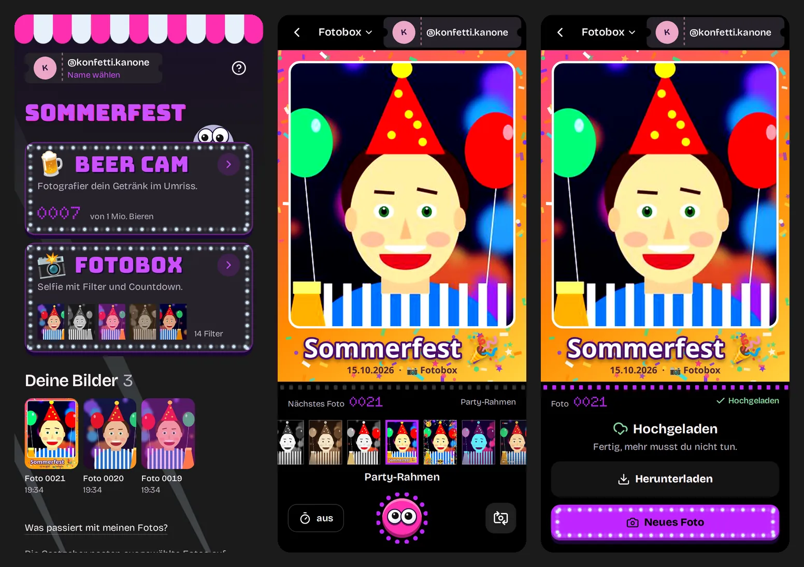
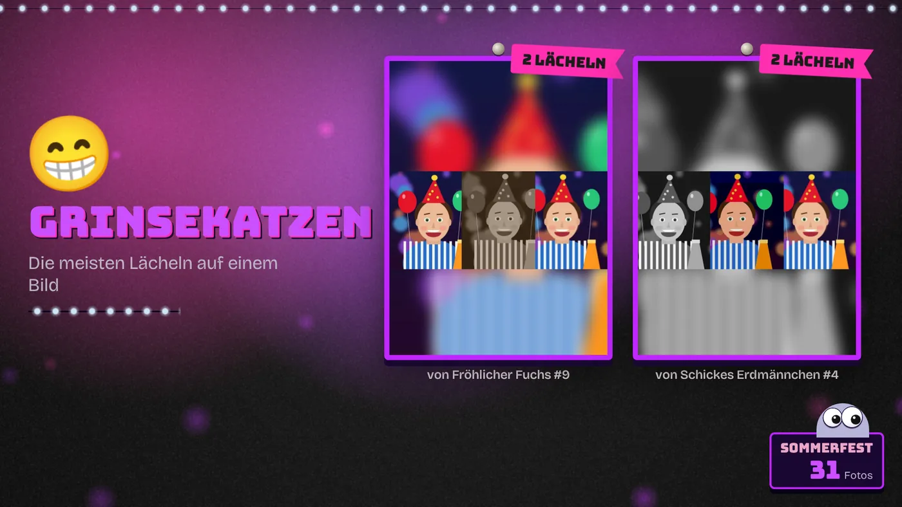
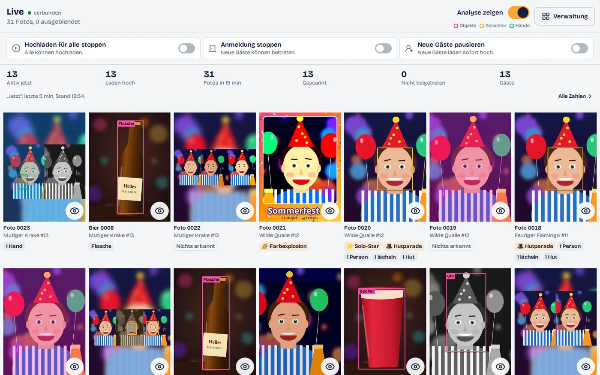
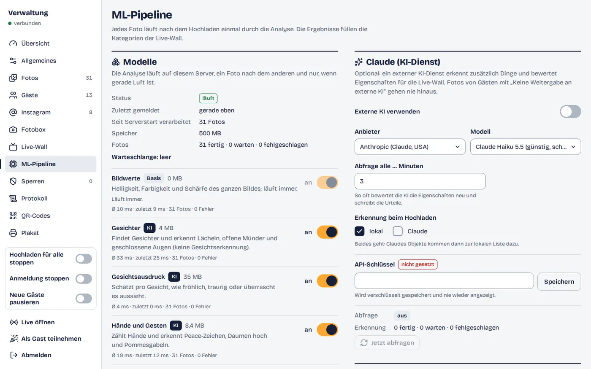
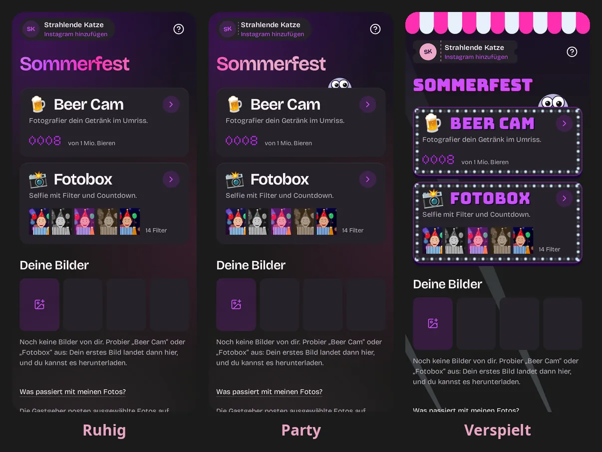

<h1 align="center">
  <picture>
    <source media="(prefers-color-scheme: dark)" srcset="docs/assets/wordmark-dark.svg">
    
  </picture>
</h1>

<p align="center">
  Party games and a photo booth on your guests' own phones.<br>
  Scan the QR code and play. No app, no sign-up.
</p>

<p align="center">
  
</p>

virtubooth is a small self-hosted web app for one party. Guests scan a QR
code, tap once and play camera games together: everyone photographs their
drink for a shared timelapse, takes selfies with silly filters, and watches
the best shots come up on the TV. The host runs everything from an admin
panel: sees the photos arrive, hides what doesn't belong, stops uploads or
new guests with one switch, and takes home the archive and the timelapse.

## What's in it

- **Beer Cam:** every drink in the same outline, numbered, counting towards a
  million; together a timelapse of the evening.
- **Fotobox:** selfies with 14 live filters and a countdown; the saved photo
  is exactly the preview.
- **Live-Wall:** the photos on a TV at `/livewall`, with transitions and fun
  categories („Grinsekatzen“, „Volles Haus“, „Prost!“) from a photo analysis
  that runs on your own server. An external AI (Anthropic or Mistral) can
  judge the winners if you switch it on, with a budget.
- **Admin panel:** live moderation, three party switches („Hochladen für alle
  stoppen“, „Anmeldung stoppen“, „Neue Gäste pausieren“), several QR codes
  with posters, guest stats, bans, an Instagram list, exports. The host can
  join as a guest too.
- **Guests:** no account, a pseudonym per phone, their own photos under
  „Deine Bilder“. Photos wait on the phone until the server has them, so a
  bad network loses nothing.
- **Private by default:** photos are re-encoded without EXIF/GPS and shown
  only to their guest and the host; guests can opt out of the analysis and
  of the external AI.

The UI is German, built for iOS Safari and Android Chrome.

<p align="center">
  
</p>

<p align="center">
  
  
</p>

## Three looks

The host picks the look of the guest pages and the Live-Wall in Admin →
„Erscheinungsbild“: the colour presets „Neon Nacht“,
„Klassisch“ and „Rummel“ (or your own colours) and a style: „Ruhig“,
„Party“ or „Verspielt“, the fairground default with signs, light bulbs,
googly eyes and a buzzer for a shutter. The default is Neon Nacht in
Verspielt.

<p align="center">
  
</p>

## Quick start

**Docker Compose** (Docker Engine 25+, about 1 GB of free RAM for the build):

```bash
git clone <your repo url> virtubooth && cd virtubooth
docker compose run --rm -T app virtubooth gen-env > .env   # builds the image, prints fresh secrets
$EDITOR .env                                                # party name, public URL, ...
docker compose up -d --build
```

Open `http://localhost:8000/?t=<VB_PARTY_TOKEN from .env>` as a guest and
`http://localhost:8000/admin` as the host. Phones only open the camera over
HTTPS, so a real party needs a domain and a TLS reverse proxy:
[docs/DEPLOY.md](docs/DEPLOY.md) has Caddy, Traefik and nginx, every setting,
backups and a party-night checklist.

**Coolify:** point a "Docker Compose" resource at
[`docker-compose.coolify.yaml`](docker-compose.coolify.yaml); Coolify sets
the domain and generates the secrets, and the photo analysis is built in.
Steps: [DEPLOY.md → Coolify](docs/DEPLOY.md#coolify).

**Local development** (needs [uv](https://docs.astral.sh/uv/), Node 22.22
and pnpm 11):

```bash
make setup        # uv sync + pnpm install
make models       # optional: the photo analysis packages and models
make build-web    # the frontend into frontend/dist
make dev          # server on :8000, creates .env with fresh secrets, prints the guest URL
make dev-web      # optional: Vite with hot reload on :5173, next to `make dev`
make check        # lint, typecheck, tests, Chromium e2e
```

`make help` lists every target. After changing a route or schema, run
`make openapi`. To try it on a real phone, deploy or tunnel the dev server
(for example `cloudflared tunnel --url http://localhost:8000`).

## Before the party

1. Deploy, log in at `/admin`, set the event name and your own password
   (Verwaltung → Allgemeines).
2. Print QR codes or posters from Verwaltung → QR-Codes; each code can lead
   to Start or straight to an activity.
3. Set a Live-Wall password and open `/livewall` on the TV.
4. During the party: moderate on Live. After it: export the archive and the
   timelapse, then delete the data ([Teardown](docs/DEPLOY.md#teardown)).

## Documentation

| File | What |
|---|---|
| [docs/FEATURES.md](docs/FEATURES.md) | every feature for guests and hosts, with limits (German) |
| [docs/DEPLOY.md](docs/DEPLOY.md) | Docker, Coolify, reverse proxy, every `VB_*` setting, the photo analysis, backups, updates, troubleshooting |
| [docs/ARCHITECTURE.md](docs/ARCHITECTURE.md) | how it works: backend layers, events, QR access, Live-Wall, frontend, adding an activity, tests, security model |
| [backend/README.md](backend/README.md), [frontend/README.md](frontend/README.md) | commands, layout and conventions of each half |
| [docs/overhaul/](docs/overhaul/), [docs/PLAN.md](docs/PLAN.md), [docs/REQUIREMENTS.md](docs/REQUIREMENTS.md) | history: the original request, early decisions, the October 2026 overhaul and its security review |

Stack: Python 3.14, FastAPI, SQLite and React 19 with TypeScript and Vite,
in one Docker container. Each activity is an extension; adding one:
[ARCHITECTURE.md → Adding an activity](docs/ARCHITECTURE.md#adding-an-activity).
