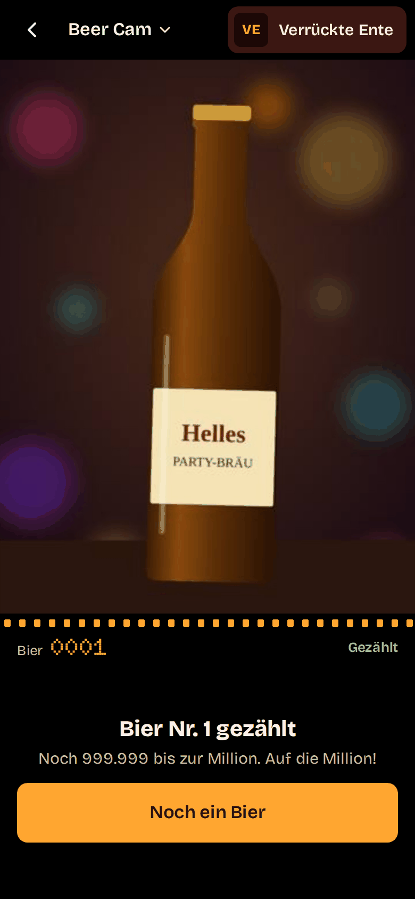
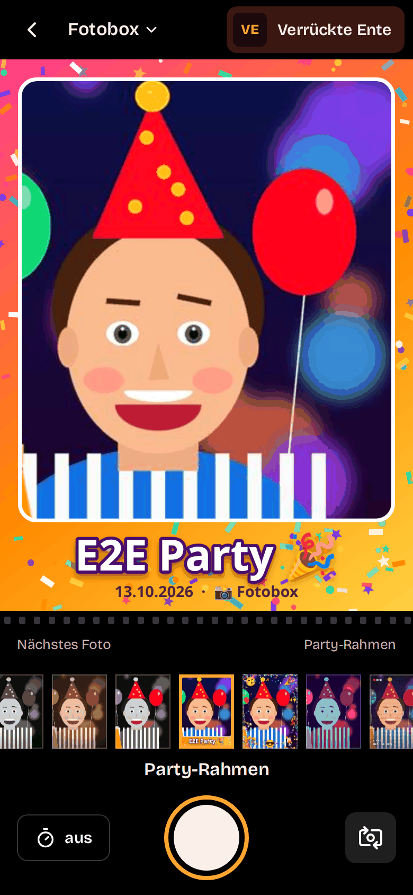
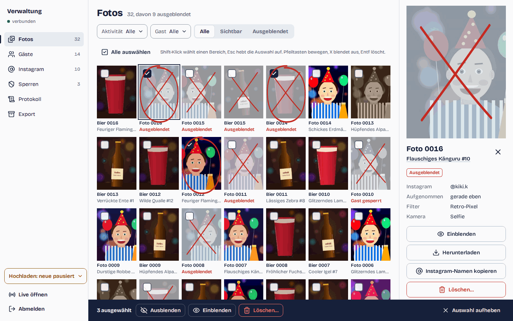

# virtubooth

A self-hosted digital photo booth for parties. Guests scan a QR code with
their phone and land on a small set of camera activities: no app, no
registration, no account. The host moderates from a laptop or phone. It all
runs as one Docker container behind any HTTPS reverse proxy.

The UI is German, phone-first and built for iOS Safari, Android Chrome,
Firefox and desktop browsers. It uses the "Kontaktbogen" design: a darkroom
with a safelight for guests and a light table with grease-pencil marks for the
host. A FastAPI backend serves a React frontend, and new activities plug in
as extensions.

<p>
  
  
  
</p>

**Contents:**
[Features](#features) ·
[Quick start (Docker)](#quick-start-docker) ·
[Local development](#local-development) ·
[Repository layout](#repository-layout) ·
[Tech stack](#tech-stack) ·
[Testing](#testing) ·
[Security model](#security-model) ·
[Extension platform](#extension-platform) ·
[Documentation](#documentation)

## Features

### For guests

- **No token, no entry.** The printed QR codes carry the party token
  (`https://<host>/?t=<token>`). Without it every page shows "Scan den
  QR-Code" (HTTP 404) and the API answers 404.
- **Join sheet.** On the first visit a sheet welcomes the guest ("Willkommen
  bei Lenas 30.!", from `VB_PARTY_NAME`), explains what happens with the
  photos (stored, maybe posted on Instagram, device recognition) and takes an
  optional Instagram name. It has one button, "Alles klar, los geht’s!", and
  no "no": declining means not using the booth. Each device gets a pseudonym
  such as "Hüpfendes Alpaka #2".
- **Start.** The party's name, one film-strip card per activity with a live
  line (the Beer Cam counter, Fotobox sample frames), and **"Deine Bilder"**:
  the guest's own visible photos, each opening large with "Speichern" (the
  share sheet on iOS). "Was passiert mit meinen Fotos?" answers the privacy
  questions.
- **Guest pass.** The pseudonym and Instagram name ("Instagram hinzufügen")
  sit in the top corner with a status dot. It opens the "Du" sheet: change
  the Instagram name, see whether uploads are paused or photos are waiting.
- **Beer Cam** (`/x/beer/`). The rear camera with a bottle outline, switchable
  to a cup ("Flasche" / "Becher"). Every photo is exactly 1080×1440 and framed
  the same way, so they make a timelapse. The guest gets a counter ("Bier
  Nr. 127 gezählt", "Noch 999.873 bis zur Million") and "Noch ein Bier".
- **Fotobox** (`/x/booth/`). The front camera with 10 real-time WebGL filters
  (Normal, Schwarz-Weiß, Sepia, Color Pop, Party-Rahmen, Emoji-Props, Neon,
  Vintage/VHS, Retro-Pixel, Comic), an optional 3-second countdown and a
  result print with "Speichern" and "Neues Foto". The saved photo is exactly
  what the preview showed.
- **Activity switcher.** The title of a camera page switches activities
  ("Aktivität wechseln").
- **Never lose a shot.** Every photo goes into an on-device outbox (IndexedDB)
  before its upload and leaves it only when the server has it. A failed upload
  shows "Erneut senden", and the outbox retries by itself (back online, tab
  visible again, every 30 s, next visit). When uploads are paused or stopped,
  the shutter is locked and says why before anyone shoots.
- **Resilient.** A boot check explains content blockers that break the page,
  in-app browsers (Instagram, WhatsApp) get a hint to open Safari or Chrome,
  and `?debug=1` shows an on-screen log on any page.

### For the host (`/admin`)

- **Login** with `VB_ADMIN_PASSWORD`, rate limited, with the lockout said in
  words ("Zu viele Fehlversuche"). The admin needs no party token. Logging out
  ends the live screens of that login at once; one browser keeps at most 4
  live tabs, and a fifth reconnects the oldest.
- **Live** (`/admin/live`). A dense grid of photos as they arrive, a 44 px
  hide toggle per photo ("Ausblenden", with "Rückgängig" in a toast), and the
  connection state ("verbunden"). You can **only hide** here, so an accidental
  tap during the party never deletes anything.
- **Verwaltung** (`/admin/manage`), a sidebar on desktop:
  - **Fotos**: a contact sheet with grease-pencil marks (X = hidden, circle =
    selected), filters (Aktivität, Gast, Sichtbar/Ausgeblendet), multi-select
    with keyboard shortcuts, an inspector panel, and "Löschen…" (removes the
    files for good; numbers are never reused).
  - **Gäste**: the guests with pseudonym, Instagram name, photo count and
    status, filterable (for example "Hochladen pausiert").
  - **Instagram**: every handle with its photos, a **ZIP per handle** to post
    from, and an **"Erledigt"** mark once you have tagged them.
  - **Sperren**: bans and **device bans** ("Gerätemerkmal"). A device ban
    starts new identities with that device trait banned ("Automatisch
    gesperrt"); lifting it releases them.
  - **Protokoll**: the audit log of every moderation action.
  - **Export**: archive (ZIP with photos, CSVs and optionally the database),
    timelapse (MP4 via ffmpeg) and QR sheet, as background jobs with progress
    and a download.
- **Guest page** (`/admin/user?id=…`): a status line, their photos, the
  per-guest "Hochladen pausieren", the ban in a sheet ("Gerätemerkmal auch
  sperren"), technical details collapsed.
- **Upload controls** (the "Hochladen" sheet behind the status pill):
  "Hochladen für alle stoppen" for a short emergency stop, "Neue Gäste
  pausieren" for whoever joins from now on (ending that pause asks whether to
  free exactly those guests or keep them paused), and the list of paused
  guests with "Hochladen für … erlauben".
- **Deep links**: `?photo=<id>` opens a photo on the live screen, in Fotos and
  on the guest page.

Everything the host does is audit-logged and pushed live to every open admin
page over Server-Sent Events.

## Quick start (Docker)

Needs Docker Engine 25+ with the Compose plugin, and about 1 GB of free RAM
for the image build (it builds the frontend too).

```bash
git clone <your repo url> virtubooth && cd virtubooth
docker compose run --rm -T app virtubooth gen-env > .env   # builds the image, prints fresh secrets
$EDITOR .env                                                # party name, public URL, ...
docker compose up -d --build
docker compose ps                                           # wait for "(healthy)"
```

Open `http://localhost:8000/?t=<VB_PARTY_TOKEN from .env>` for the guest view
and `http://localhost:8000/admin` for the host. On the first run Compose
prints "pull access denied for virtubooth" before it builds the image; that is
expected.

Phones only allow the camera over **HTTPS**, so a real party needs a domain
and a TLS reverse proxy (Caddy, Traefik, nginx or Coolify).
[docs/DEPLOY.md](docs/DEPLOY.md) covers the proxy, Coolify, every `VB_*`
setting, backups, updates, the exports and troubleshooting. All settings are
also listed in [.env.example](.env.example).

## Local development

Needs [uv](https://docs.astral.sh/uv/) (it installs Python 3.14 itself),
Node 22.22 (`frontend/.node-version`) and pnpm 11
(`npm install -g pnpm@11.28.5`). `make help` lists every task.

```bash
make setup                  # uv sync + pnpm install
make browsers               # once: Playwright's Chromium and Firefox for e2e
```

Two ways to run it:

```bash
# 1) the built UI, as in production: one server on :8000
make build-web
make dev                    # creates .env with fresh secrets if missing, prints the guest URL

# 2) hot reload while working on the UI: two terminals
make dev                    # API on :8000 (placeholder pages if there is no build)
make dev-web                # Vite on :5173, proxies /api, /media and ?t= to :8000
```

With `make dev-web`, open `http://localhost:5173/?t=<VB_PARTY_TOKEN>`; the
dev-only UI gallery is at `http://localhost:5173/__ui`. Ports are overridable:
`make dev PORT=8100` and `make dev-web PORT=8100 WEB_PORT=5200`. `make dev`
keeps its data in `./data` (`DATA_DIR=` to change).

After changing an API route or schema, run `make openapi`: it exports
`frontend/openapi.json` and regenerates the typed client
(`frontend/src/api/schema.gen.ts`). Both are committed, and CI fails on drift.

Testing on a real phone needs HTTPS: deploy, or tunnel the dev server (for
example `cloudflared tunnel --url http://localhost:8000`), then open the token
URL on the phone. Android: `chrome://inspect` over USB. iOS: Safari's Web
Inspector on a Mac, or `?debug=1`.

## Repository layout

```
virtubooth/
├── backend/                     Python package + tests (backend/README.md)
│   ├── pyproject.toml  uv.lock  .python-version
│   ├── src/virtubooth/
│   │   ├── __main__.py          CLI: serve | gen-env | export-openapi
│   │   ├── app.py               create_app(): the composition root
│   │   ├── settings.py          VB_* settings (pydantic-settings)
│   │   ├── core/  db/  domain/  repositories/  services/  api/  web/
│   │   ├── extensions/          sdk.py + one package per activity: beer/, booth/
│   │   └── tools/               qr, timelapse, export (python -m virtubooth.tools.<x>)
│   └── tests/                   unit/, api/, e2e/ (Playwright), fixtures/
├── frontend/                    React app (frontend/README.md)
│   ├── index.html  admin.html  gate.html   the three entries (guest, admin, gate)
│   ├── openapi.json             generated from the backend, committed
│   ├── patches/                 react-aria CSP patch (pnpm patchedDependencies)
│   ├── public/  scripts/
│   └── src/
│       ├── api/                 typed client generated from openapi.json, errors, events
│       ├── ui/                  design system (React Aria + Tailwind, "Kontaktbogen")
│       ├── styles/              app.css: tokens, fonts
│       ├── sdk/                 guest runtime: session, camera, upload, outbox, components
│       ├── guest/  admin/       the two apps
│       ├── extensions/          registry.ts + one folder per activity: beer/, booth/
│       └── lib/                 de-DE formatting, German copy
├── docs/                        ARCHITECTURE.md, DEPLOY.md, REQUIREMENTS.md, overhaul/
├── scripts/                     docker-smoke.sh, smoke.py
├── .github/workflows/ci.yml
├── Dockerfile  .dockerignore  compose.yaml  docker-compose.coolify.yaml
└── Makefile  ruff.toml  .editorconfig  .env.example
```

## Tech stack

| Area | What (pinned versions) |
|---|---|
| Backend | Python 3.14 (3.12+ works), FastAPI 0.143, Pydantic 2.14 + pydantic-settings 2.15, uvicorn 0.54 (one worker), SQLite (stdlib `sqlite3`, WAL), Pillow 12.3, segno 1.6 (QR), ffmpeg (timelapse) |
| Frontend | React 19.3 with the React Compiler, TypeScript 6.0 (strict), Vite 8.3 (multi-page, Rolldown), Tailwind CSS 4.3 + tailwind-variants, react-aria-components 1.22, TanStack Query 5, wouter 3, zustand 5, zod 4 (`zod/mini`), lucide-react, Bricolage Grotesque + Doto (self-hosted) |
| API client | openapi-typescript 7.13 + openapi-fetch 0.17, generated from the backend's OpenAPI export |
| Tooling | uv 0.12, pnpm 11.28 on Node 22.22, ruff 0.17, mypy 2.4 (strict), oxlint 1.87 (type-aware) + Prettier 3.9 |
| Tests | pytest 9, Vitest 5 + Testing Library (happy-dom), Playwright 1.63 (Chromium, Firefox, WebKit) |
| Runtime | Docker image: `python:3.14.8-slim-trixie` + ffmpeg, built with `node:22.22.1-trixie-slim`; Compose and Coolify files |

## Testing

```bash
make lint                   # ruff (all Python, Markdown snippets), oxlint + prettier
make typecheck              # mypy --strict, tsc -b
make test                   # backend unit + API tests (pytest), frontend unit tests (Vitest)
make e2e                    # builds frontend/dist, browser tests in Chromium
make e2e-firefox            # the same in Firefox
make e2e-webkit             # the same in WebKit, inside the Playwright Docker image
make docker-smoke           # build the image, run it, check it end to end
make check                  # everything CI runs
```

- **Unit and API tests** (`backend/tests/unit`, `backend/tests/api`): the
  whole HTTP API through FastAPI's TestClient, the migrations, the tools, the
  OpenAPI export, the web serving contract. **Vitest** (`frontend/src/**/*.test.ts(x)`):
  the SDK (session state machine, outbox, upload, camera crop math), the API
  error mapping, formatting, contrast of the colour tokens, key components.
- **End to end** (`backend/tests/e2e`): pytest drives Playwright against a live
  server that serves the **built** `frontend/dist`. Phones get fake front and
  back cameras, desktops a webcam. Every test ends with zero console errors,
  which also catches CSP violations. Pick the browser with
  `VB_E2E_BROWSER=chromium|firefox`, or run WebKit (Safari's engine) with
  `backend/tests/e2e/run_webkit.sh` in `mcr.microsoft.com/playwright/python:v1.63.0-noble`.
  Extra pytest arguments: `make e2e E2E_ARGS="-k beer -x"`.
- **Content-blocker audit.** uBlock, AdGuard, Brave and iOS blockers drop URLs
  and hide elements that look like ads, tracking or cookie notices, which can
  silently break a page. Names stay neutral everywhere, and three checks keep
  them so: `pnpm build` fails on blocker-prone file names and CSS selectors
  (`scripts/check-names.mjs`); `tests/unit/test_core_blockers.py` matches
  every URL (and `frontend/public`, the HTML entries and the source paths)
  against a vendored set of real filter rules; and the e2e suite scans the
  rendered pages (every main screen of the guest app, the activities and the
  admin). For the full lists (about 40 MB, downloaded once):
  `cd backend && VB_BLOCKLISTS=.blocklists uv run pytest tests/unit/test_core_blockers.py`
  (the same variable feeds the e2e scans).
- **Docker smoke** (`scripts/docker-smoke.sh`): runs the image like
  `compose.yaml` does (read-only, no capabilities, fresh volume and secrets)
  and checks the image (USER 10001, no `VB_DEV`, no `.env`), the gate, the
  token entry, hashed and precompressed assets, the root-file allow-list, the
  CSP, a guest joining and uploading, the admin login and event stream, one
  export job of each kind, the CLI tools and a clean stop.

## Security model

- **Party token.** Everything a guest sees needs the token from the QR code.
  A valid `?t=` sets an HttpOnly access cookie (an HMAC of the token, 30 days)
  and redirects to the same URL without the token. The access log masks it,
  and pages send `Referrer-Policy: no-referrer`. Rotating `VB_PARTY_TOKEN`
  locks every guest out until they scan a new code.
- **Guest identity without accounts.** Joining creates a pseudonymous guest
  pinned to the device by a signed cookie, plus a localStorage copy. Device
  traits are stored as a moderation **hint**, never as an identity:
  identical phones often look the same.
- **Admin.** A password from the environment: at least 12 characters, and
  use 16+ random ones (`gen-env` makes one; the log warns at startup when it
  is shorter than 16 characters or very repetitive). The session is a random
  token stored hashed, in a `SameSite=Strict` cookie that expires
  (`VB_ADMIN_SESSION_HOURS`, 12 h; log in before the guests arrive).
- **Admin login lock.** Login is rate limited per IP (5 per minute, 20 per
  hour; IPv6 per /64). After 20 wrong passwords within 15 minutes from
  anywhere, **every** login is refused for 5 minutes (429 with `Retry-After`,
  "Zu viele Fehlversuche"), the correct password too, so spreading guesses
  over many addresses gains nothing. Admins who are logged in keep working.
  To get in during a lock, wait, or restart the container (`docker compose
  restart app`; the counters live in memory). A login sent from the server
  itself straight to the app's port (no proxy) is exempt. See
  [DEPLOY.md](docs/DEPLOY.md#locked-out-of-the-admin-login).
- **Every state-changing request** passes a CSRF check of the full origin
  (scheme, host and port: `VB_PUBLIC_BASE_URL`, `VB_ALLOWED_ORIGINS` or the
  request's own; `http://` origins are refused on https deployments), a body
  size cap, and per-device, per-IP and global rate limits.
- **Uploads** are validated (JPEG only, the activity's exact size, at most
  100 scans, byte caps) and re-encoded, so all metadata is stripped
  (EXIF/GPS, XMP, ICC, comments) and never reaches the disk. Photos are stored
  outside the web root, and a photo is served only to its guest and the
  admin.
- **Pages.** Without the party cookie only the gate and a short allow-list of
  root files (`boot-check.js`, icons, `robots.txt`) are served. HTML is
  `private, no-cache`; the token redirect is `no-store`.
- **Strict CSP**: `script-src 'self'; style-src 'self'`, no inline scripts or
  styles, no external hosts, plus `X-Frame-Options: DENY`, COOP/CORP and a
  Permissions-Policy that allows only the camera. A pnpm patch removes the
  two runtime `<style>` injections of React Aria that the CSP would block.
- **Container.** Runs as uid 10001 on a read-only root filesystem, without
  Linux capabilities and with `no-new-privileges`, CPU/memory/PID limits and
  a health check. Everything it writes is in the `/data` volume.
- **Exports.** The database copy in the admin's archive and in the CLI
  export holds guests with IPs, fingerprints and bans, all photo rows and the
  audit log, but no admin sessions and no export jobs, and it is vacuumed so
  nothing deleted earlier can be recovered.
- **Retention.** Hidden photos stay on disk; only deleting removes files.
  After the party, export what you keep and delete the volume
  ([docs/DEPLOY.md](docs/DEPLOY.md#teardown)).
- The full security review of the overhaul, with what was fixed and what was
  accepted: [docs/overhaul/SECURITY_REVIEW.md](docs/overhaul/SECURITY_REVIEW.md).

## Extension platform

Each activity is an extension in two halves that share an id:

- **Backend**: a package `backend/src/virtubooth/extensions/<id>/` that exports
  `extension = Extension(...)`: title, tagline, an optional `UploadPolicy`
  (exact size, allowed metadata, a validator), an optional API router mounted
  at `/api/x/<id>/`, and an optional `on_upload` hook whose fields join the
  upload answer.
- **Frontend**: a folder `frontend/src/extensions/<id>/` whose `index.ts`
  registers a lazily loaded page for `/x/<id>/`. The page builds on the guest
  SDK: `useSession`/`canUpload`, the camera session (preview == photo), `useShot`
  (outbox and upload with progress), and the `ActivityShell` page frame with
  the guest pass, film edge and shutter.

Core does the rest: discovery (`VB_EXTENSIONS` picks and orders them), the
gate, the join flow, the upload pipeline and storage, rate limits,
moderation, the start-screen card, the activity switcher, the admin views,
the QR codes, the exports and the timelapse. The Live Wall from the original
spec can come back the same way.
[docs/ARCHITECTURE.md → Adding an activity](docs/ARCHITECTURE.md#adding-an-activity)
walks through a complete, working example.

## Documentation

| File | What |
|---|---|
| [docs/ARCHITECTURE.md](docs/ARCHITECTURE.md) | backend layers, request flow, events, web serving, frontend apps, SDK, design system, adding an activity |
| [docs/DEPLOY.md](docs/DEPLOY.md) | Docker, Compose, Coolify, reverse proxy and HTTPS, every `VB_*` variable, backups, updates, exports, troubleshooting |
| [backend/README.md](backend/README.md) | backend commands, package layout, rules of thumb |
| [frontend/README.md](frontend/README.md) | frontend scripts, structure, conventions (CSP, neutral names, the React Aria patch, locale pin, tokens) |
| [docs/overhaul/](docs/overhaul/) | the 2026 overhaul: brief, plan, contracts (API, web serving), design system "Kontaktbogen" |
| [docs/REQUIREMENTS.md](docs/REQUIREMENTS.md) | the original request; [docs/PLAN.md](docs/PLAN.md) the decisions taken before the overhaul |
