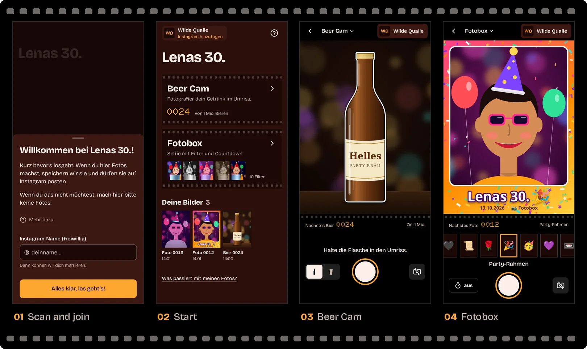
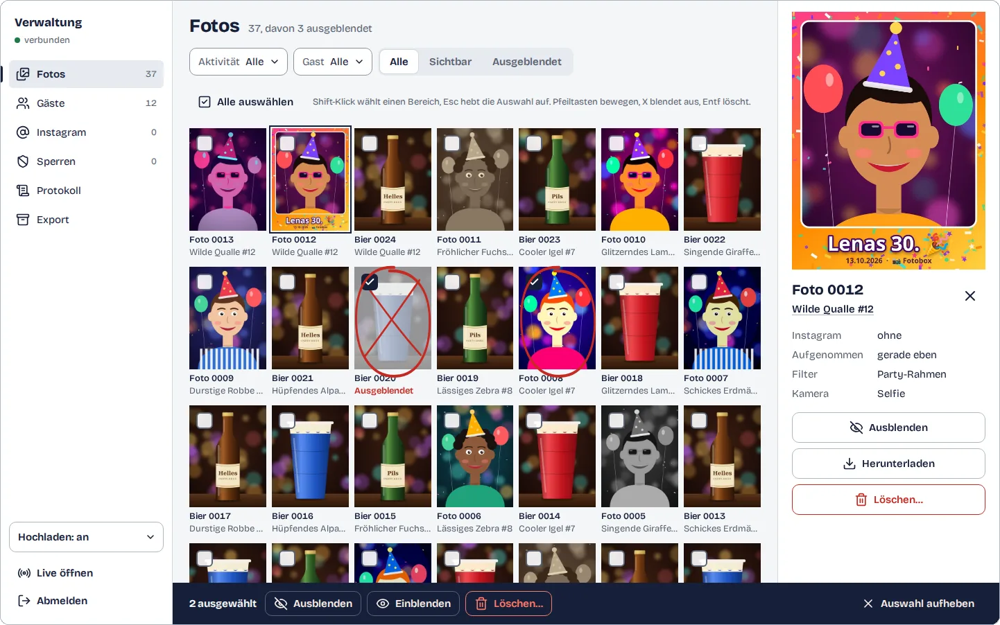

<p align="center">
  <picture>
    <source media="(prefers-color-scheme: dark)" srcset="docs/assets/logo-dark.svg">
    
  </picture>
</p>

<h1 align="center">virtubooth</h1>

<p align="center">
  Photo games for your party, played on the guests' own phones.<br>
  Scan the QR code and you're in. No app, no sign-up.
</p>

<p align="center">
  
</p>

**Contents:**
[What is this?](#what-is-this) ·
[How a party works](#how-a-party-works) ·
[The activities](#the-activities) ·
[The admin panel](#the-admin-panel) ·
[Quick start](#quick-start) ·
[Configuration](#configuration) ·
[Privacy and security](#privacy-and-security) ·
[For developers](#for-developers)

## What is this?

virtubooth is a small web app for one party. The guests play camera games
together on their phones: everyone photographs their drink for a shared
timelapse, or takes selfies with filters. To join, a guest scans a QR code.
One tap and they are in: no app, no account, no password. The host runs
everything from an admin panel: watches the photos come in, hides what does
not belong, and takes home the photo archive and the timelapse.

- **Self-hosted.** One Docker container on your server, behind HTTPS. Photos
  and data stay in one volume.
- **Phone first.** The UI is German and built for iOS Safari, Android
  Chrome, Firefox and desktop browsers.
- **The "Kontaktbogen" design.** Every photo is a frame on the party's film
  roll. Guests work in a darkroom with an amber safelight; the host reviews
  on a light table with grease-pencil marks.
- **Modular.** Each game is an extension. New games plug in without changes
  to the core.

## How a party works

1. **Set it up.** Deploy the container ([quick start](#quick-start)), set the
   party name and print the QR codes: admin → Verwaltung → Export →
   "QR-Bogen erstellen" makes one A4 page per code.
2. **Guests scan and join.** The code opens the party in the phone's browser.
   A sheet greets them ("Willkommen bei Lenas 30.!"), says what happens with
   the photos and asks for an optional Instagram name. One tap on
   "Alles klar, los geht’s!" and they are in. There is no "no" button:
   whoever does not want their photos taken does not use the booth. Each
   phone gets a pseudonym such as "Wilde Qualle #12".
3. **They play.** Start lists the activities. Each photo goes to the server
   and appears under "Deine Bilder", where the guest can save it.
4. **The host moderates live.** New photos show up on the admin's live
   screen as they arrive. One tap hides a photo. In Verwaltung the host can
   delete photos, ban a guest, pause uploads and collect the Instagram names.
5. **After the party.** Export the photo archive, the Beer Cam timelapse and
   the Instagram list. Then delete the data.

## The activities

### Beer Cam

Everyone photographs their drink inside the same outline: a bottle, or a cup
("Flasche" / "Becher"). Every photo is framed the same way and exactly
1080×1440, so together they make a timelapse of the evening. After each shot
the guest sees the count ("Bier Nr. 24 gezählt", "Noch 999.976 bis zur
Million") and "Noch ein Bier". It uses the rear camera, at `/x/beer/`.

### Fotobox

Selfies with the front camera, 10 live filters and an optional 3-second
countdown. The filters are WebGL shaders: Normal, Schwarz-Weiß, Sepia,
Color Pop, Party-Rahmen (with the party's name), Emoji-Props, Neon,
Vintage/VHS, Retro-Pixel and Comic. The saved photo is exactly what the
preview showed. The result comes as a print with "Speichern" and
"Neues Foto". It lives at `/x/booth/`.

### In every activity

- **"Deine Bilder"** on Start: the guest's own visible photos. Each opens
  large with "Speichern" (the share sheet on iOS).
- **The guest pass** in the top corner shows the pseudonym and a status dot.
  It opens the "Du" sheet: add or change the Instagram name ("Instagram
  hinzufügen"), and see whether uploads are paused or photos are waiting.
- **"Was passiert mit meinen Fotos?"** on Start answers the privacy
  questions.
- **Switch activities** from the title of a camera page ("Aktivität
  wechseln").
- **No lost shots.** Each photo goes into an outbox on the device
  (IndexedDB) first, and leaves it only when the server has it. A failed
  upload shows "Erneut senden", and the outbox retries by itself: back
  online, tab visible again, every 30 s, on the next visit. When uploads are
  paused or stopped, the shutter is locked and says why before anyone shoots.
- **Robust.** A boot check explains content blockers that break the page,
  in-app browsers (Instagram, WhatsApp) get a hint to scan the QR code with
  the phone's camera app instead, and `?debug=1` shows an on-screen log on any
  guest page.

## The admin panel

<p align="center">
  
</p>

The host logs in at `/admin` with `VB_ADMIN_PASSWORD`, on a laptop or a
phone. The admin needs no party token. Every open admin page updates live
(Server-Sent Events), and every action goes into the audit log.

**Live** (`/admin/live`) is for the party itself: a dense grid of the photos
as they arrive, with the connection state ("verbunden"). A 44 px toggle per
photo hides or unhides it ("Ausblenden", with "Rückgängig" in a toast). There
is **no delete** here, so an accidental tap never deletes anything.

**One-tap stops.** The Live header and the Verwaltung header have "Hochladen
stoppen" (nobody can upload) and "Anmeldung stoppen" (nobody new can join;
guests who joined carry on): side by side on Live, stacked in the sidebar on a
laptop. One tap, no confirmation. While a stop is on, its button gives way to a red or
amber status strip ("Hochladen gestoppt", "Anmeldung gestoppt") with the
resume button, the same on every open admin screen.

**Live overview.** Under the Live header, and in full in the "Übersicht" tab:
active now, uploading now (both the last 5 minutes), photos in the last 15 and
60 minutes, scanned, not joined, guests, Instagram, paused, banned, per
activity. It refreshes every 10 seconds and on every relevant event.

**Verwaltung** (`/admin/manage`) has seven tabs, in a sidebar on desktop:

| Tab | What the host does there |
|---|---|
| Übersicht | The live overview in full: the numbers above, grouped, with how they are counted. |
| Fotos | A contact sheet with grease-pencil marks (X = hidden, circle = selected). Filters (Aktivität, Gast, Sichtbar/Ausgeblendet), multi-select with keyboard shortcuts, an inspector, and "Löschen…", which removes the files for good (numbers are never reused). |
| Gäste | Every guest with pseudonym, Instagram name, photo count and status, filterable (for example "Hochladen pausiert"). |
| Instagram | Every Instagram name with its photos, a **ZIP per name** to post from, and an **"Erledigt"** mark once you have tagged them. |
| Sperren | Bans and **device bans** ("Gerätemerkmal"). A device ban starts new identities with that device trait banned ("Automatisch gesperrt"); lifting it releases them. |
| Protokoll | The audit log of every moderation action. |
| Export | The archive (ZIP with photos, CSVs and optionally the database), the timelapse (MP4 via ffmpeg) and the QR sheet, as background jobs with progress and a download. |

Also in the admin:

- **Guest page** (`/admin/user?id=…`): a status line, the guest's photos,
  "Hochladen pausieren" for this guest, and the ban in a sheet
  ("Gerätemerkmal auch sperren"). Technical details are collapsed.
- **Upload controls**: the status pill opens the "Hochladen" sheet.
  "Hochladen für alle stoppen" is a short emergency stop. "Neue Gäste
  pausieren" holds back whoever joins from now on; ending that pause asks, if
  anyone joined during it, whether to free exactly those guests or keep them
  paused. The list of paused guests has "Freigeben" for each.
- **Login and sessions**: the login is rate limited and says so in words
  ("Zu viele Fehlversuche"). Logging out ends the live screens of that login
  at once. One browser keeps at most 4 live tabs; a fifth reconnects the
  oldest.
- **Deep links**: `?photo=<id>` opens a photo on the live screen, in Fotos
  and on the guest page.

## Quick start

### Docker Compose

Needs Docker Engine 25+ with the Compose plugin, and about 1 GB of free RAM
for the image build (it builds the frontend too).

```bash
git clone <your repo url> virtubooth && cd virtubooth
docker compose run --rm -T app virtubooth gen-env > .env   # builds the image, prints fresh secrets
$EDITOR .env                                                # party name, public URL, ...
docker compose up -d --build
docker compose ps                                           # wait for "(healthy)"
```

Open `http://localhost:8000/?t=<VB_PARTY_TOKEN from .env>` as a guest and
`http://localhost:8000/admin` as the host. On the first run Compose prints
"pull access denied for virtubooth" before it builds the image; that is
expected.

Phones only open the camera over **HTTPS**, so a real party needs a domain
and a TLS reverse proxy (Caddy, Traefik, nginx or Coolify).
[docs/DEPLOY.md](docs/DEPLOY.md) covers the proxy, every setting, backups,
updates, the exports, a party-night checklist and troubleshooting.

### Coolify

[`docker-compose.coolify.yaml`](docker-compose.coolify.yaml) is made for
Coolify's "Docker Compose" build pack. Coolify sets the domain and generates
the secrets, so you need no `.env` and no proxy setup. The steps:
[DEPLOY.md → Coolify](docs/DEPLOY.md#coolify).

### Local development

Needs [uv](https://docs.astral.sh/uv/) (it installs Python 3.14 itself),
Node 22.22 (`frontend/.node-version`) and pnpm 11
(`npm install -g pnpm@11.28.5`). `make help` lists every task.

```bash
make setup        # uv sync + pnpm install
make build-web    # the production frontend build into frontend/dist
make dev          # one server on :8000; creates .env with fresh secrets if missing, prints the guest URL
```

- **Hot reload for the UI:** run `make dev` (the API on :8000, placeholder
  pages without a build) and `make dev-web` (Vite on :5173, proxies `/api`,
  `/media` and `?t=` to :8000) in two terminals. Open
  `http://localhost:5173/?t=<VB_PARTY_TOKEN>`; the dev-only UI gallery is at
  `http://localhost:5173/__ui`.
- **Ports and data:** `make dev PORT=8100`, `make dev-web PORT=8100
  WEB_PORT=5200`. `make dev` keeps its data in `./data` (`DATA_DIR=` to
  change).
- **API changes:** after changing a route or schema, run `make openapi`. It
  exports `frontend/openapi.json` and regenerates the typed client
  (`frontend/src/api/schema.gen.ts`). Both are committed, and CI fails on
  drift.
- **On a real phone:** the camera needs HTTPS, so deploy, or tunnel the dev
  server (for example `cloudflared tunnel --url http://localhost:8000`), then
  open the token URL on the phone. Android: `chrome://inspect` over USB. iOS:
  Safari's Web Inspector on a Mac, or `?debug=1`.

## Configuration

Settings are `VB_*` environment variables. With Compose they live in `.env`,
in Coolify in its Environment Variables. The ones you will touch:

| Variable | What |
|---|---|
| `VB_PARTY_TOKEN` | **Required.** The secret in every QR code URL (`?t=`). Changing it locks every guest out until they scan a new code. |
| `VB_ADMIN_PASSWORD` | **Required.** The admin password: at least 12 characters, better 16+ random ones (`gen-env` makes one). |
| `VB_SECRET_KEY` | **Required.** Signs the cookies, at least 32 characters. |
| `VB_PARTY_NAME` | Shown on Start, in the join sheet and on the QR sheet. Default `Party`. |
| `VB_INSTAGRAM_ACCOUNT` | The account you may post photos to, named in the join sheet. |
| `VB_PUBLIC_BASE_URL` | The public URL, e.g. `https://party.example.com`. The QR codes use it. |
| `VB_EXTENSIONS` | The activities to enable, in this order, e.g. `beer,booth`. Default: all. |
| `VB_COOKIE_SECURE`, `VB_FORWARDED_ALLOW_IPS` | Behind a TLS proxy: `true`, and the proxy's address. |

Every setting with its default, including the rate limits:
[DEPLOY.md → Settings](docs/DEPLOY.md#settings) and
[.env.example](.env.example).

## Privacy and security

- **No QR code, no entry.** Every guest page and API call needs the party
  token from the QR code. Without it, every page shows "Scan den QR-Code"
  (HTTP 404) and the API answers 404.
- **No accounts.** A guest is a pseudonym tied to one device by a signed
  cookie. The Instagram name is optional. Device traits are kept only as a
  hint for bans, never as an identity.
- **An anonymous scan count.** Each browser that opens the QR link gets a
  random id cookie, stored with its first and last visit only (no IP, no
  device data), so the host's overview can count scans. The guest's "Mehr
  dazu" says so, and the archive's database copy leaves these ids out.
- **Private photos.** Uploads are re-encoded, which strips EXIF/GPS and all
  other metadata. A photo is served only to the guest who took it and to the
  admin.
- **A guarded admin.** One password from the environment, a rate-limited
  login that locks for everyone after 20 wrong guesses, and sessions that
  expire.
- **Hardened by default.** A strict CSP with no external hosts, a CSRF
  origin check on every change, rate limits per device, IP and party, and a
  container that runs without root on a read-only filesystem.
- **You decide what stays.** Hidden photos stay on disk until you delete
  them. After the party, export what you keep and delete the volume
  ([DEPLOY.md → Teardown](docs/DEPLOY.md#teardown)).

Every layer in detail: [ARCHITECTURE.md → Security model](docs/ARCHITECTURE.md#security-model).
What the overhaul's security review found, fixed and accepted:
[docs/overhaul/SECURITY_REVIEW.md](docs/overhaul/SECURITY_REVIEW.md).

## For developers

One process serves everything: a FastAPI app with the JSON API, the photos,
the admin event stream and the built React frontend. State lives in SQLite
plus photo files. How it fits together: [docs/ARCHITECTURE.md](docs/ARCHITECTURE.md).

### Stack

| Area | What |
|---|---|
| Backend | Python 3.14, FastAPI, Pydantic, SQLite (WAL), Pillow, segno (QR), ffmpeg (timelapse); one uvicorn worker |
| Frontend | React 19 with the React Compiler, TypeScript (strict), Vite (three entries), Tailwind CSS 4, React Aria Components, TanStack Query |
| API client | Typed, generated from the backend's OpenAPI export (openapi-typescript + openapi-fetch) |
| Tooling | uv, pnpm, ruff, mypy (strict), oxlint, Prettier |
| Tests | pytest, Vitest + Testing Library, Playwright (Chromium, Firefox, WebKit) |
| Runtime | One Docker image (Python slim + ffmpeg, the frontend built inside); Compose and Coolify files |

The exact versions: [ARCHITECTURE.md → Stack](docs/ARCHITECTURE.md#stack).

### Repository layout

```
virtubooth/
├── backend/                  FastAPI app and all Python tests (backend/README.md)
│   ├── src/virtubooth/       app.py, settings.py, core/ db/ domain/ repositories/ services/ api/ web/
│   │   ├── extensions/       sdk.py + one package per activity: beer/, booth/
│   │   └── tools/            qr, timelapse, export (python -m virtubooth.tools.<x>)
│   └── tests/                unit/, api/, e2e/ (Playwright), fixtures/
├── frontend/                 React app (frontend/README.md)
│   ├── index.html  admin.html  gate.html   the three entries: guest, admin, gate
│   ├── openapi.json          generated from the backend, committed
│   ├── patches/              react-aria CSP patch (pnpm patchedDependencies)
│   └── src/                  guest/ admin/ extensions/ sdk/ ui/ api/ lib/ styles/
├── docs/                     ARCHITECTURE.md, DEPLOY.md, REQUIREMENTS.md, overhaul/, assets/
├── scripts/                  docker-smoke.sh, smoke.py
├── .github/workflows/ci.yml
├── Dockerfile  .dockerignore  compose.yaml  docker-compose.coolify.yaml
└── Makefile  ruff.toml  .editorconfig  .env.example
```

### Tests and make targets

```bash
make browsers       # once: Playwright's Chromium and Firefox for e2e
make lint           # ruff (all Python, Markdown snippets), oxlint + prettier
make typecheck      # mypy --strict, tsc -b
make test           # backend unit + API tests (pytest), frontend unit tests (Vitest)
make e2e            # builds frontend/dist, browser tests in Chromium
make e2e-firefox    # the same in Firefox
make e2e-webkit     # the same in WebKit, inside the Playwright Docker image
make docker-smoke   # build the image, run it, check it end to end
make check          # everything CI runs
```

What each suite covers, the e2e harness, the content-blocker audit and the
Docker smoke test: [ARCHITECTURE.md → Testing](docs/ARCHITECTURE.md#testing).

### Adding an activity

Each activity is an extension in two halves that share an id:

- **Backend:** a package `backend/src/virtubooth/extensions/<id>/` that
  exports `extension = Extension(...)`: title, tagline, an optional
  `UploadPolicy` (exact size, allowed metadata, a validator), an optional API
  router at `/api/x/<id>/`, and an optional `on_upload` hook whose fields join
  the upload answer.
- **Frontend:** a folder `frontend/src/extensions/<id>/` whose `index.ts`
  registers a lazily loaded page for `/x/<id>/`. The page builds on the guest
  SDK: the session, the camera (preview == photo), the outbox and upload, and
  the `ActivityShell` page frame with the guest pass, film edge and shutter.

The core does the rest: discovery (`VB_EXTENSIONS` picks and orders them),
the gate, joining, the upload pipeline and storage, rate limits, moderation,
the Start card, the activity switcher, the admin views, the QR codes, the
exports and the timelapse. The Live Wall for a TV from the original spec can
come back the same way.
[ARCHITECTURE.md → Adding an activity](docs/ARCHITECTURE.md#adding-an-activity)
walks through a complete, working example.

### Documentation

| File | What |
|---|---|
| [docs/FEATURES.md](docs/FEATURES.md) | every feature, in German: for guests, the host and operators, with the screen it is on, the limits and the settings |
| [docs/ARCHITECTURE.md](docs/ARCHITECTURE.md) | backend layers, request flow, events, web serving, frontend apps, SDK, design system, adding an activity, testing, security model, stack |
| [docs/DEPLOY.md](docs/DEPLOY.md) | Docker, Compose, Coolify, reverse proxy and HTTPS, every `VB_*` variable, backups, updates, exports, troubleshooting |
| [backend/README.md](backend/README.md) | backend commands, package layout, rules of thumb |
| [frontend/README.md](frontend/README.md) | frontend scripts, structure, conventions (CSP, neutral names, the React Aria patch, locale pin, tokens) |
| [docs/overhaul/](docs/overhaul/) | the 2026 overhaul: brief, plan, contracts (API, web serving), design system "Kontaktbogen" |
| [docs/REQUIREMENTS.md](docs/REQUIREMENTS.md) | the original request; [docs/PLAN.md](docs/PLAN.md) the decisions taken before the overhaul |
