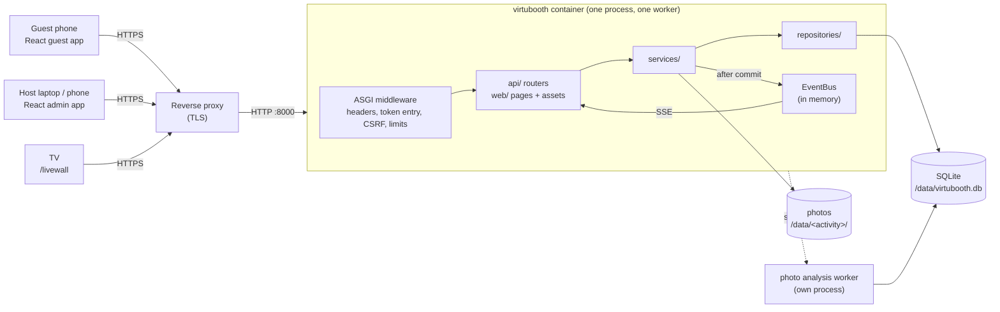
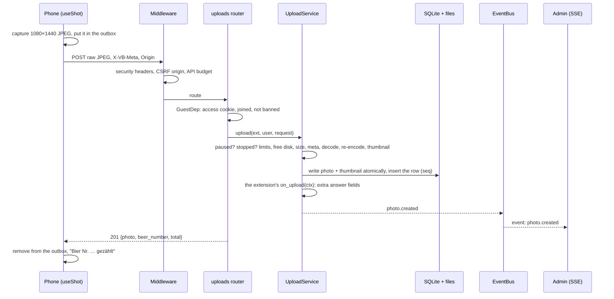
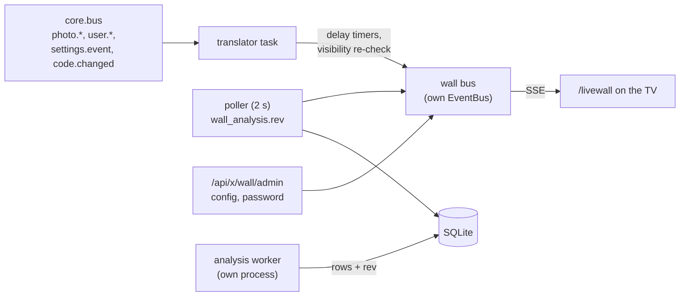

# virtubooth architecture

One process serves everything: a FastAPI app (one uvicorn worker) with the
JSON API, the photos, the admin event stream and the built React frontend.
State lives in SQLite plus photo files under `VB_DATA_DIR`. In production it
runs in Docker behind a TLS reverse proxy ([DEPLOY.md](DEPLOY.md)), because
phones only open the camera over HTTPS. What the app does for guests and
hosts: [FEATURES.md](FEATURES.md) (German).



**One worker, on purpose.** Rate limits and the event bus live in process
memory. Never run several workers or replicas.

Contents:
[Backend](#backend) ·
[A request, end to end](#a-request-end-to-end) ·
[Transactions, audit, events](#transactions-audit-events) ·
[QR codes and party access](#qr-codes-and-party-access) ·
[Presence](#presence) ·
[Web serving](#web-serving) ·
[The Live-Wall](#the-live-wall) ·
[Frontend](#frontend) ·
[Adding an activity](#adding-an-activity) ·
[Testing](#testing) ·
[Security model](#security-model) ·
[Stack](#stack)

## Backend

`backend/src/virtubooth/`, layered. Imports point downwards: a router never
touches SQL, a repository never publishes an event. Commands and rules of
thumb: [backend/README.md](../backend/README.md).

| Layer | Path | What it does |
|---|---|---|
| Entry | `__main__.py` | CLI: `serve` (default), `gen-env`, `export-openapi`, `reset-admin-password`, `wall` |
| Composition | `app.py`, `runtime.py`, `settings.py` | `create_app(settings, extensions=None)` builds `Core` (settings, db, repos, services, bus, signer, limits, web, extensions). `Settings` is pydantic-settings over `VB_*`; a bad value fails startup with the variable's name |
| core | `core/` | errors (`ErrorCode`, `ErrorBody`, `ApiError`), security (signing, cookies, origin check, headers, client IP), events (`EventBus`, replay), rate limits, passwords (scrypt), token-masking access log |
| db | `db/` | `Database`: one SQLite connection (WAL) behind a lock, nested transactions, after-commit hooks. `migrations.py`: numbered steps, append only |
| domain | `domain/` | dataclasses, constants (1080×1440, id patterns), pseudonyms, QR code rules |
| repositories | `repositories/` | one per aggregate, plus read models for the admin lists. SQL only |
| services | `services/` | the business logic and the only place that opens a write transaction: identity, uploads, moderation, upload controls, admin auth, codes, presence, exports (one worker thread), theme, host settings, typed events |
| api | `api/` | `deps.py` (access dependencies), `schemas/` (Pydantic in/out models, the `AdminEvent` union), `routers/` (guest, uploads, media, health, `admin/*`) |
| web | `web/` | serves the built frontend from `VB_WEB_DIR` ([Web serving](#web-serving)) |
| extensions | `extensions/` | `sdk.py` (`Extension`, `UploadPolicy`, discovery), `beer/`, `booth/` and `wall/` ([The Live-Wall](#the-live-wall)) |
| tools | `tools/` | `qr`, `timelapse`, `export`: CLI tools whose functions the admin's export jobs reuse |

Access levels are FastAPI dependencies from `api/deps.py`:

| Dependency | Needs | Fails with |
|---|---|---|
| `AccessDep` | the `vb_access` cookie of an active QR code | 404 `scan_qr` |
| `MeDep`, `GuestDep` | access + a joined guest (`vb_uid`, signed) that is not banned | 401 `needs_consent`, 403 `banned` |
| `AdminDep` | a live admin session (`vb_admin`, hashed in the DB) | 401 `admin_required` |

Errors are always `ErrorBody {error: ErrorCode, message}` with a German
`message` the UI shows as is. Every route declares its response model and
error statuses, so `virtubooth export-openapi` writes a complete schema;
`frontend/openapi.json` is generated from it and CI fails on drift. That
schema is the API contract. [overhaul/contracts/api.md](overhaul/contracts/api.md)
explains the error codes, export kinds and the audit vocabulary from the
overhaul; later routes (QR codes, theme, Live-Wall) are only in the schema.

**Database.** Core tables: `users`, `user_fingerprints`, `fingerprint_bans`,
`photos`, `admin_sessions`, `audit_log`, `settings` (key/value: switches,
Instagram marks, event name, theme, public address, admin password hash,
`x.*` extension settings), `export_jobs`, `visitors`, the QR code tables
(migration 5), and the Live-Wall's analysis, object, category and LLM tables
(migrations 9 to 11). Migration 12 adds the admin guest (`users.is_host`), 13 the
Fotobox originals (`photos.raw_filename`). A
schema change is a new step in `db/migrations.py`; never edit a released one.

## A request, end to end

A Beer Cam upload, `POST /api/x/beer/upload`:



1. `SecurityHeadersMiddleware` (outermost) adds the CSP and the other headers.
2. `GuardMiddleware` (pure ASGI, `middleware.py`): a `GET` with `?t=` is the
   token entry (valid → 303 without `t` plus the access cookie, invalid → the
   gate); every `POST/PUT/PATCH/DELETE` needs a matching `Origin` (or
   `Referer`), see [Security model](#security-model); JSON bodies need a
   `Content-Length` of at most 64 KiB; `/api/*` counts against a request
   budget (per device for joined guests, per IP otherwise, none for admins).
3. The router resolves the access dependency, calls one service method and
   builds the response model.
4. The service owns the work and the transaction.
5. Errors become `ErrorBody` JSON; a 404 outside `/api` becomes the gate or
   the not-found page.

## Transactions, audit, events

A change, its audit entry and its event commit together or not at all:

```python
def hide_photo(self, public_id: str, *, actor: str, reason: str = HIDDEN_BY_ADMIN) -> PhotoChange:
    with self.db.tx():  # BEGIN IMMEDIATE (a savepoint when nested)
        changed = self.repos.photos.hide(public_id, at=now_iso(), reason=reason)
        photo = self.repos.photos.get(public_id)
        if changed:
            self.repos.audit.log(actor, "photo.hide", f"photo:{public_id}", at=now_iso())
            if photo is not None:
                self.events.photo_hidden(AdminPhoto.of(photo))  # queued until COMMIT
    return PhotoChange(changed, photo)
```

- `Database.tx()` holds the connection lock, opens `BEGIN IMMEDIATE` (nested
  calls use savepoints) and rolls back on any exception.
- `AdminEvents._emit()` registers `db.on_commit(...)`: an event goes out only
  once the change is durable. Files of a deleted photo are unlinked after the
  commit too.
- The admin's „Protokoll“ shows the audit log.

**The admin event stream.** `GET /api/admin/events` is Server-Sent Events.
Each event has a type (`photo.created`, `user.banned`, `code.changed`, …), a
JSON payload and an id `<epoch>-<n>`; the epoch changes with every start.

- Every admin answer carries `X-VB-Event-Id`, the stream position before the
  request. Opening the stream with `?since=<id>` loses nothing in between.
- The server keeps the last 1024 events for replay (`Last-Event-ID`). Too old,
  or a restart: `stream.resync`, and the page refetches everything. A client
  256 events behind is disconnected and replays on reconnect.
- One session holds at most 4 streams (a fifth closes the oldest). Logout
  closes its streams at once; expiry and password changes are caught every
  30 s. A `: ping` goes out after 15 s of silence, with
  `X-Accel-Buffering: no`.
- Client: `frontend/src/admin/store/stream.ts` polls every 5 s while the
  stream is down; `applyEvent.ts` patches the React Query cache.

## QR codes and party access

A party has several QR codes (`domain/codes.py`, `repositories/codes.py`,
`services/codes.py`, `api/routers/admin/codes.py`).

| Table | Holds |
|---|---|
| `party_codes` | number (never reused), animal (name `"<animal> <id>"`), current `token`, `token_gen` (+1 per change), `target`, `note`, `revoked_at` |
| `party_code_tokens` | every token a code ever had, as SHA-256; no token is handed out twice |
| `code_visitors` | which browser (`vb_vid`) opened which code, first/last time, scans |
| `users.code_id` | the code a guest joined through, set once |

- **Seeding.** On start, if `party_codes` is empty, `CodesService.ensure_seeded()`
  creates code 1 with `VB_PARTY_TOKEN` (or a generated token) and adopts all
  earlier guests and visitors. From then on the database is the only source
  of tokens; a changed `VB_PARTY_TOKEN` only logs a warning.
- **Scan.** The token is hashed and looked up among the current tokens of
  active codes (hash then lookup, so timing reveals nothing). A hit sets
  `vb_access`, counts the scan and redirects without `t`. Browsers without a
  visitor id are counted only within `VB_SCANS_PER_IP_PER_10MIN`; over it
  they still get in. Wrong tokens over 60 per minute and IP get their gate
  1 s late (an `asyncio.sleep`), so guessing stays slow but one device can't
  lock out a venue Wi-Fi.
- **Access cookie.** `vb_access` = `signer.sign("access", "<code id>.<token_gen>")`.
  It grants access while its code is active and at that generation. After a
  revoke or a token change it still works for a joined guest (`vb_uid`
  finds a user), never for a browser that never joined. Cookies from before
  the codes count as code 1, generation 1.
- **Tokens.** Generated: `secrets.token_urlsafe(18)`. Custom: 16–128 of
  `[A-Za-z0-9_-]` with at least 6 distinct characters. The audit log keeps
  only the last 4 characters.
- **Statistics.** `CodeStats` (one query for all codes): scans, people,
  guests, not joined, photos, active now, online time.
- **Printing.** PNG, big QR and poster are built in the admin's browser
  ([Posters and printing](#posters-and-printing)); the A4 sheet for every
  activity is `python -m virtubooth.tools.qr`.

**Admin guest.** `POST /api/admin/guest` (admin session, CSRF-checked)
creates the one guest with `is_host = 1` on the first call and sets this
browser's `vb_uid`. It has no code and no access cookie (a signed guest id is
enough for `require_access`), is exempt from the new-guest pause, the join
stop and the photo limit, and cannot be banned (409 `host_guest`). A guest
can never become it.

## Presence

"Aktiv jetzt" and the online time come from two signals
(`services/presence.py`):

- **Last seen.** Every guest request refreshes `users.last_seen_at` (or the
  visitor's), at most once per device and minute.
- **The heartbeat.** `POST /api/here {visible}`. The guest app sends
  `visible: true` at start and every 60 s while the page is visible, and
  `visible: false` once (a `keepalive` fetch) when it is hidden or left.
  A visible beat within 150 s of the last adds the time to
  `online_seconds`; otherwise it starts a new visit (`online_sessions`). A
  visible beat less than 20 s after the last written one is not written, so a
  looping client costs nothing. 300 guests make about 5 small writes a second.

**Host settings** (`services/host_settings.py`, `services/theme.py`): the
event name, the public address (wins over `VB_PUBLIC_BASE_URL` for codes,
posters and the wall, never for CSRF or cookies; saving fetches
`<address>/healthz?probe=<nonce>` and checks the server's own MAC, so only
this server passes) and the theme (`x.theme`: preset, colours, style;
default Neon Nacht with style `goofy`; text needs 4.5:1 on background and
surface). The guest pages get the theme before the first paint through
`<html data-vb-style>` and a `/api/theme.css?v=<rev>` link, no inline style.

**Guest names.** `users.display_name` (NULL = default). The shown name is the
display name, else „@instagram“, else the pseudonym; the wall and the
external AI use „@instagram“ only while the wall shows handles.
`PATCH /api/me` validates it (NFKC, 2–24 characters, no control or
invisible characters, not reserved, not another guest's name).

### Unfiltered originals

A Fotobox photo has its filter baked in (the stored JPEG is exactly the
preview). With a filter other than „Normal“ the client also renders the frozen
frame without shader and overlay (`renderShot`, same crop and mirroring) and
appends it to the same upload; its length is in `X-VB-Raw-Bytes`. Both parts
pass the photo checks; an original equal to the photo is dropped. Activities
opt in with `UploadPolicy.accepts_raw`.

- Files `<ext>/raw/<stem>.jpg` (+ `raw/thumbs/`), columns `raw_filename`,
  `raw_thumb_filename` (migration 13, NULL = none).
- Served as `/media/{id}?variant=raw` with the photo's access rules; the wall
  never serves it. API fields `raw_url`, `raw_thumb_url`.
- The analysis and the external detection read `COALESCE(raw_filename,
  filename)`. The archive export takes `filters: baked | raw | both`.

## Web serving

The backend serves the built frontend from `VB_WEB_DIR` (`/app/web` in the
image, `frontend/dist` locally). Without it the server refuses to start
unless `VB_DEV=1` (placeholder pages for `vite dev`). Contract:
[overhaul/contracts/web-serving.md](overhaul/contracts/web-serving.md).

| Path | Answer |
|---|---|
| `/`, `/x/<id>/…` | `index.html` with access, else the gate (404) |
| `/admin/login` | `admin.html`, public |
| `/admin/…` | `admin.html` with a session, else 303 to `/admin/login?next=…` |
| `/livewall` | `wall.html`, public; the page asks for the wall password |
| `/assets/*` | hashed files, `immutable` for a year; the `.br`/`.gz` sibling when accepted |
| `/<file>` | only `PUBLIC_ROOT_FILES` (`boot-check.js`, `gate-hint.js`, `icon.svg`, `favicon.ico`, `apple-touch-icon.png`, `robots.txt`) |
| anything else | the not-found page (404), or the gate without access |

- `gate.html` holds both 404 messages; the server flips `data-vb-mode` to
  `notfound`. It works without JavaScript.
- HTML is `private, no-cache` with an ETag; the `?t=` redirect is `no-store`.
  Dot segments are refused, so `.vite/manifest.json` is never served.
- A new file in `frontend/public/` that must be reachable needs an entry in
  `PUBLIC_ROOT_FILES` (`web/frontend.py`).

## The Live-Wall

`extensions/wall/` (backend), `frontend/wall.html` + `src/wall/` (the TV),
`src/admin/wall/` and `src/admin/ml/` (the admin tabs). An extension without
uploads and without a Start card (`show_on_home=False`). It uses the generic
hooks of `Extension`:

- `web_router`, mounted outside `/api/`: `/livewall`, `/livewall/api/*`,
  `/livewall/media/*`. The wall cookie `vb_wall` is scoped to `/livewall`,
  and the TV never shares the venue's per-IP `/api/` budget.
- `admin_router` at `/api/x/wall/admin/…`: config, password, categories,
  analysis, LLM. Admin sessions are exempt from the API budget there.
- `on_start` / `on_stop`: start and stop the hub, the analysis supervisor and
  the LLM threads.
- `derived_files`: the wall's 1280 px copies, deleted with the photo.



- **Screen access.** The password hash is scrypt; the cookie is
  `signer.sign("wall", "<gen>.<issued>.<nonce>")`, and the generation grows on
  every password change or „Alle Wände abmelden“, which ends every wall.
  Login: 5/min and 20/h per IP, and a global 5-minute lock after 20 wrong
  passwords in 15 minutes. Per wall cookie: 120 requests a minute for
  session, feed, categories and stream, 1200 for media, at most 4 streams.
- **The wall bus.** A translator task subscribes to `core.bus`: new and
  unhidden photos arm a timer for `created_at + delay_s` and, after a
  visibility re-check, become `photo.add`; hidden, deleted and banned ones
  become `photo.remove` at once; event name, QR code and theme changes
  republish `config`. A poller reads the analysis change counter every 2 s
  (`photo.update`, `categories.changed`). Each wall stream replays with
  `Last-Event-ID`, else `stream.resync` refetches the feed.
- **Feed:** visible, not deleted, from a configured source, older than the
  delay; the newest 1000.
- **Photo analysis** (`enrich/`). `start()` spawns
  `python -m virtubooth.extensions.wall.enrich worker` under a supervisor
  thread: stdin is a pipe (EOF = the app is gone), restart with backoff,
  exit 75 = recycle after 200 photos or 900 MB RSS, nice 10;
  `VB_WALL_WORKER=off` never spawns it. The worker claims the newest pending
  photo, runs the analyzers in dependency order (basic always, ML with the
  `ml` extra and models) and writes facts, boxes and the object list in one
  transaction. It imports neither FastAPI nor the extensions.
- **Frozen data.** A photo is analysed once. `wall_facts`, `photo_objects` and
  `photo_detection_runs` have UPDATE-abort triggers; `enrich/objects.py` only
  appends (external AI objects). A failed attempt is retried while fewer than
  3 attempts ran. Deleting a photo purges all of it.
- **Test images** go through files in `<data>/wall/test/`; the worker answers
  between photos; nothing becomes a photo.
- **Categories** (`enrich/engine.py`, table `wall_categories`): each row is a
  JSON spec (`where` conditions on value keys, `select` top/bottom with
  tie-breakers, `label`, optional `verdict.prompt`), validated by
  `engine.validate` (400 `invalid_category` with the field). `evaluate` runs
  over a cached snapshot per analysis revision. `presets.py` seeds the 20
  templates once.
- **Opt-outs.** `users.analysis_opt_out` and `users.ai_opt_out`, written only
  by the guest API, are read live: the engine leaves analysis-opted-out
  guests out of every category, and the external path re-checks both (plus
  bans, hidden and deleted photos) right before every call.
- **External AI** (`llm/`, off by default). Two daemon threads: detection (one
  photo at a time after the local pipeline, ≤ 1024 px without EXIF, objects
  appended with source `claude` or `mistral`) and the poller (every
  `poll_interval_s`, text only: one call per property in chunks of up to 400
  objects, then one verdict per category with a prompt; skipped when the
  input is unchanged). Providers `anthropic` (official SDK) and `mistral`
  (plain HTTPS). Every call goes through `LlmService.call`, which checks the
  budget and meters `llm_usage`. Guest text goes in a `<data>` block the
  system prompt marks as data; answers are validated and capped.
- **The API key** (`llm/crypto.py`): AES-256-GCM, key = HKDF-SHA256 over
  `VB_SECRET_KEY`, the provider as AAD. The API only says whether it is set;
  log filters mask keys; archives drop the row.

## Frontend

`frontend/`, React 19 + TypeScript + Vite, a multi-page app. Scripts and
conventions: [frontend/README.md](../frontend/README.md).

| Entry | App | Routes |
|---|---|---|
| `index.html` → `src/guest/` | guest | `/` (Start), `/x/<id>/*` (an activity, lazy) |
| `admin.html` → `src/admin/` | admin | `/admin/login`, `/admin/live`, `/admin/manage?tab=…`, `/admin/user?id=…` |
| `wall.html` → `src/wall/` | Live-Wall | `/livewall` |
| `gate.html` | none | static „Scan den QR-Code“ / „Hier ist nichts“ |

The guest and admin entries load `/boot-check.js` first: if the app never
sets `window.__vbReady` (usually a content blocker dropped a chunk), it
shows a German hint.

**The guest SDK** (`src/sdk/`), what every activity builds on:

| Module | Gives you |
|---|---|
| `session.ts` | `useSession()`: `loading → needs_join → ready ⇄ banned`; `canUpload(state)` says whether the guest may upload and why not |
| `camera/` | `useCameraSession()` (getUserMedia with the iOS quirks, WebGL1 with a Canvas2D fallback, `capture()` = the 3:4 preview at 1080×1440), `CameraStage`, `CameraErrorScreen`, `filters.ts` (Fotobox shaders), `overlays.ts` (Beer Cam outlines) |
| `camera/useShot.ts` | one photo's life: capture → outbox → upload → result, with `take`, `retry`, `dismiss` |
| `upload.ts`, `outbox.ts` | XHR upload with progress; the IndexedDB outbox |
| `components/` | `ActivityShell` (the camera page frame), `ActivityMenu`, `GuestPass`, `GuestSheet` |

**Design.** The admin is the „Kontaktbogen“ light table: white, grease-pencil
marks (X = hidden, circle = selected), the film edge whose sprocket holes
show upload progress ([overhaul/design/DESIGN.md](overhaul/design/DESIGN.md)
records the original design; its darkroom colours for guests are replaced by
the theme). Guest pages and the wall take the host's theme: colour tokens as
CSS variables, and a style layer on `<html data-vb-style>`: `elegant`
(„Ruhig“), `party` (`party.css`) and `goofy` („Verspielt“, `goofy.css`:
Bungee signs, bulbs, googly eyes, the buzzer shutter). Fonts are Bricolage
Grotesque, Doto (numerals) and Bungee, self-hosted. Tokens live in
`src/styles/app.css`; `contrast.test.ts` checks the colour pairs against
WCAG AA. `src/ui/` holds presentational components only; a dev-only gallery
shows them at `/__ui`.

**The API client** (`src/api/`): `schema.gen.ts` is generated from
`openapi.json` (`make openapi`); `client.ts` wraps openapi-fetch and turns
every failure into an `ApiError` with the German message; `scan_qr` reloads
the page so the gate shows.

### Posters and printing

The admin builds every printable file in its own browser; the server only
stores the template (`<data>/poster/template.pdf`, ≤ 8 MB, served with
`Content-Security-Policy: sandbox`) and the QR field (`services/posters.py`).
`src/print/` is framework-free and loaded lazily (`qrPng`, `bigQrPdf`,
`posterPdf`): pdf-lib with the PDF standard fonts only, QR codes with error
correction "high" as vector rectangles, the template page embedded exactly as
pdf.js shows it (`print/geometry.ts`, tested for all rotations). The preview
uses pdf.js's legacy build (iOS 16/17) with its worker as a same-origin file,
because the CSP allows no blob workers.

## Adding an activity

An activity is an **extension**: a backend package and a frontend folder with
the same id. The core does everything else:

| You write | Core gives you |
|---|---|
| `Extension(...)` in `backend/src/virtubooth/extensions/<id>/__init__.py` | discovery and `VB_EXTENSIONS`; `POST /api/x/<id>/upload` with access, join, ban and pause checks, rate limits, validation, re-encoding, thumbnails, storage, numbering and the `photo.created` event; your router at `/api/x/<id>/`; the Start card; the admin filters, inspector labels, Instagram ZIP, archive and timelapse; the Live-Wall |
| a page in `frontend/src/extensions/<id>/` | the route `/x/<id>/` behind the gate and the join sheet, a lazy chunk, the activity switcher, „Deine Bilder“, the guest pass, the outbox, the film edge and the design system |

The guest app shows an activity when both halves exist: the server lists it
(`GET /api/extensions`, filtered and ordered by `VB_EXTENSIONS`) and the build
has a page for it (`extensions/registry.ts`, `import.meta.glob`).
`test_frontend_contract.py::test_extension_folders_match_the_backend` fails
when one half is missing. Optional: `admin_router` at `/api/admin/x/<id>/`
(the Fotobox keeps its filter switches there), `web_router`, `on_start`,
`on_stop` (the Live-Wall uses them).

### A complete example: „Schnappschuss“

The smallest camera activity: one photo, no frills. This code compiles and
was tested in Chromium with a fake camera.

**1. Choose an id** matching `^[a-z][a-z0-9-]{1,30}$`: the package, the
folder, the URL (`/x/snap/`) and the photo folder (`data/snap/`). Keep it
neutral for content blockers: no `ad`, `track`, `banner`, `pixel`.

**2. Backend:** `backend/src/virtubooth/extensions/snap/__init__.py`.

```python
"""Schnappschuss: one photo, nothing else. The smallest camera activity."""

from typing import Any

from virtubooth.domain.constants import FACINGS, PHOTO_HEIGHT, PHOTO_WIDTH
from virtubooth.extensions.sdk import Extension, UploadPolicy


def validate_meta(meta: dict[str, Any]) -> dict[str, Any]:
    if meta.get("facing") not in FACINGS:
        raise ValueError("Unbekannte Kamera.")  # → 400 invalid_meta, shown to the guest
    return {"facing": meta["facing"]}


extension = Extension(
    id="snap",
    title="Schnappschuss",
    emoji="📷",
    tagline="Ein Foto, sonst nichts.",
    upload=UploadPolicy(
        max_side=PHOTO_HEIGHT,
        min_side=480,
        exact_size=(PHOTO_WIDTH, PHOTO_HEIGHT),  # 1080×1440, like Beer Cam and Fotobox
        meta_keys=frozenset({"facing"}),
        validate_meta=validate_meta,
    ),
    order=30,
    meta_labels={"facing": "Kamera"},
)
```

`upload` makes it a photo activity (`UploadPolicy` also takes `quality`,
`thumb_side`, `max_bytes`); `meta_keys` are the only keys the client may send
in `X-VB-Meta`. `order` sorts activities when `VB_EXTENSIONS` is empty,
`meta_labels` names the keys in the admin, `emoji` appears on the CLI's QR
sheet.

**3. Registration:** `frontend/src/extensions/snap/index.ts`.

```ts
import { defineExtension } from '@/sdk/extension';

/** Schnappschuss: one photo, nothing else. */
export default defineExtension({ id: 'snap', load: () => import('./SnapPage') });
```

**4. The page:** `frontend/src/extensions/snap/SnapPage.tsx`.

```tsx
import { t } from '@/lib/messages.de';
import { STREAM_SIZE } from '@/sdk/camera/capture';
import { CameraErrorScreen } from '@/sdk/camera/CameraScreens';
import { CameraStage, PREVIEW_CANVAS_CLASS } from '@/sdk/camera/CameraStage';
import { useCameraSession } from '@/sdk/camera/useCameraSession';
import { useShot } from '@/sdk/camera/useShot';
import { ActivityMenu } from '@/sdk/components/ActivityMenu';
import { ActivityShell } from '@/sdk/components/ActivityShell';
import { GuestPass } from '@/sdk/components/GuestPass';
import type { ExtensionPageProps } from '@/sdk/extension';
import { canUpload, useSession } from '@/sdk/session';
import { Button } from '@/ui/Button';
import { FilmEdge } from '@/ui/FilmEdge';
import { Shutter } from '@/ui/Shutter';

const TITLE = 'Schnappschuss';

export default function SnapPage({ id }: ExtensionPageProps) {
  const session = useSession();
  const gate = canUpload(session); // paused, stopped or banned: say so before the shot
  const {
    videoRef,
    mountRef,
    session: camera,
    camera: cam,
  } = useCameraSession({
    enabled: session.status === 'ready', // the camera prompt never comes before joining
    facing: 'user',
    ...STREAM_SIZE.booth,
    canvasClassName: PREVIEW_CANVAS_CLASS,
  });
  const { shot, take, dismiss } = useShot(id); // outbox first, then the upload
  const live = cam.status === 'live' && cam.ready;

  const shoot = async () => {
    if (!camera || !live || !gate.ok) return;
    const blob = await camera.capture(); // exactly the 1080×1440 preview
    await take(blob, { facing: cam.facing }); // the X-VB-Meta the backend validates
  };
  const again = async () => {
    dismiss();
    await camera?.resume();
  };

  return (
    <ActivityShell
      heading={TITLE}
      title={<ActivityMenu currentId={id} title={TITLE} />}
      topRight={<GuestPass compact />}
      stage={
        <CameraStage videoRef={videoRef} mountRef={mountRef} ready={live || !!shot}>
          {shot ? (
            
          ) : null}
        </CameraStage>
      }
      filmEdge={
        <FilmEdge
          label="Foto"
          {...(shot?.result ? { frame: shot.result.photo.seq } : {})}
          state={shot?.status === 'uploading' ? 'uploading' : shot?.status === 'done' ? 'done' : 'idle'}
          progress={shot?.progress ?? 0}
          progressLabel={t.uploading}
        />
      }
      hint={<p>{gate.ok ? 'Lächeln!' : gate.message}</p>}
      controls={
        shot ? (
          <Button variant="primary" size="lg" block onPress={() => void again()}>
            {t.newPhoto}
          </Button>
        ) : (
          <>
            <span aria-hidden="true" className="size-12" />
            <Shutter
              state={!live ? 'not-ready' : gate.ok ? 'ready' : 'blocked'}
              onPress={() => void shoot()}
            />
            <span aria-hidden="true" className="size-12" />
          </>
        )
      }
      controlsLayout={shot ? 'actions' : 'camera'}
      holdLayout={!!shot}
    >
      {cam.status === 'error' && cam.error ? <CameraErrorScreen error={cam.error} /> : null}
    </ActivityShell>
  );
}
```

The page renders inside the session gate (joined, not banned). `useShot`
puts the photo into the outbox before uploading, so nothing is lost; add
`useOutboxToasts` and `retry` for the Beer Cam's „Erneut senden“.
`ActivityShell` handles the layouts and keeps the stage 3:4.

**5. Update the two tests that pin the activity list:**
`frontend/src/extensions/registry.test.ts` and
`backend/tests/api/test_core_access.py::test_discover_respects_explicit_order`.

**6. Run it:** `make build-web && make dev`, then `make lint typecheck test`.
With `VB_EXTENSIONS` set, add the id there. The OpenAPI schema does not
change: uploads go through the shared route.

**Going further** (Beer Cam and Fotobox are the full references): your own
router (`router=APIRouter()`, every route protected by a dependency from
`virtubooth.api.deps`; writes belong in a service inside `db.tx()` with an
audit entry); extra upload answer fields (`on_upload(ctx)` plus
`upload_result=<model>`, then `make openapi`); a server-side catalogue like
`booth/filters.json`; overlays as SVG in photo coordinates; a live line on
the Start card (`card` in `defineExtension`), a switcher icon (`ICONS` in
`ActivityMenu.tsx`) and a frame word (`FRAME_WORD` in `lib/format.ts`); e2e
tests in `backend/tests/e2e/activities/`.

**Rules for activity code:** no inline `<style>`/`<script>`, `eval`,
`dangerouslySetInnerHTML` or `setAttribute('style')` (React's `style={{…}}`
is fine); neutral names (`pnpm build` fails otherwise); German copy from
`lib/messages.de.ts`, numbers through `lib/format.ts`; design tokens only;
capture exactly the preview at 1080×1440, mirror only the front camera, ask
for the camera only after joining.

## Testing

| Suite | Where | Run |
|---|---|---|
| unit + API | `backend/tests/unit`, `backend/tests/api` (TestClient, stub web dir) | `make test` |
| frontend unit | `frontend/src/**/*.test.ts(x)`, Vitest on happy-dom | `make test` |
| e2e | `backend/tests/e2e/{guest,activities,admin,wall}`, Playwright against a live server serving `frontend/dist` | `make e2e`, `e2e-firefox`, `e2e-webkit`, `e2e-changed` |
| content blockers | `scripts/check-names.mjs` (build), `test_core_blockers.py`, `test_blockers_e2e.py` | `make build-web`, `make test` |
| container | `scripts/docker-smoke.sh` + `scripts/smoke.py` | `make docker-smoke` |

- `make check` is the everyday gate (OpenAPI drift, lint, typecheck, tests,
  Chromium e2e); `make check-all` adds Firefox, WebKit (in the Playwright
  Docker image) and the Docker smoke test. `make help` lists every target.
- The e2e suite runs in parallel (`E2E_WORKERS=4`, 0.8 to 1 GB of RAM each,
  about 2 min per browser; `0` = one process for `--pdb`). Each test has its
  own server and data directory; phones get fake front and back cameras
  (`VB_FAKE_VIDEO=clip.y4m` for your own clip), and every test fails on a
  console error, which also catches CSP violations. Targeted runs:
  `make e2e E2E_ARGS="tests/e2e/admin -k live"` (paths from `backend/`).
- Fixtures: `backend/tests/conftest.py` (`settings`, `app`, `client`,
  `guest()`, `admin`), `backend/tests/e2e/conftest.py` (`live`, `page`,
  `admin_page`, `new_context`, `join_via_api`, `track_errors`, `shot`).
- Content blockers (uBlock, AdGuard, Brave, iOS) hide anything that looks
  like ads or cookie notices. The build fails on blocker-prone names, a unit
  test matches every URL against real filter rules
  (`VB_BLOCKLISTS=.blocklists` for the full lists), and the e2e suite scans
  the rendered pages.
- The Docker smoke test runs the image like `compose.yaml` (read-only, no
  capabilities, fresh volume) and checks the gate, token entry, assets, CSP,
  a guest upload, the admin login and stream, both export kinds, the CLI
  tools and a clean stop.

## Security model

- **QR codes.** Everything a guest sees needs an active code's token. The
  access cookie is HttpOnly; the token leaves the URL at once, the access log
  masks it (`?t=***`) and pages send `Referrer-Policy: no-referrer`.
- **Guests without accounts.** A pseudonym tied to the device by a signed
  cookie. Device traits are a moderation hint, never an identity.
- **Admin.** One shared password: `VB_ADMIN_PASSWORD` (at least 12
  characters, compared in constant time), then the one set in the admin,
  stored as a scrypt hash (n = 2^15, r = 8, p = 1, `core/passwords.py`). A
  session is a random token stored hashed, in a `SameSite=Strict` cookie that
  expires. Each session carries a tag of the password it logged in with, so a
  change (also from the CLI, read on every request) ends all other sessions.
  A wrong current password answers 403 `wrong_password` and counts as a
  failed login.
- **Login lock.** 5 per minute and 20 per hour per IP; after 20 wrong
  passwords in 15 minutes from anywhere, every login is refused for 5 minutes
  (429 `login_locked`), the right one too. Logged-in admins keep working.
  Direct loopback logins are exempt.
- **CSRF.** Every `POST/PUT/PATCH/DELETE` needs an `Origin` (or `Referer`)
  whose scheme, host and port match `VB_PUBLIC_BASE_URL`, an entry of
  `VB_ALLOWED_ORIGINS`, or the request's own origin (https only with a
  trusted `X-Forwarded-Proto`, an https public URL or
  `VB_COOKIE_SECURE=true`). `http://` origins are refused on https
  deployments. Otherwise 403 `bad_origin`.
- **Uploads** are validated (JPEG, the activity's exact size, at most 100
  progressive scans, 25 megapixels) and re-encoded, so EXIF/GPS, XMP, ICC and
  comments never reach the disk. Photos live outside the web root; a photo is
  served only to its guest and the admin.
- **Headers.** CSP on every answer: `default-src 'self'; script-src 'self';
  style-src 'self'; img-src 'self' blob: data:; media-src 'self' blob:;
  connect-src 'self'; font-src 'self'; object-src 'none'; base-uri 'none';
  form-action 'self'; frame-ancestors 'none'`. Plus `X-Frame-Options: DENY`,
  `nosniff`, COOP/CORP, a Permissions-Policy that allows only the camera, and
  HSTS over https. API answers are `no-store`. `/docs` and `/openapi.json`
  are off. A pnpm patch removes React Aria's two runtime `<style>` injections.
- **Container.** uid 10001, read-only root filesystem, no capabilities,
  `no-new-privileges`, CPU/memory/PID limits; everything written is in
  `/data`.
- **Exports.** The archive's database copy leaves out admin sessions, export
  jobs, visitor ids and the AI key, and is vacuumed; it does hold IPs, device
  traits, QR tokens and the password hash. What is stored about guests:
  [FEATURES.md](FEATURES.md#was-über-gäste-gespeichert-wird).
- The overhaul's security review, with what was fixed and accepted:
  [overhaul/SECURITY_REVIEW.md](overhaul/SECURITY_REVIEW.md).

| Cookie | Holds | Lifetime | Flags |
|---|---|---|---|
| `vb_access` | signed code number and token generation | 30 days | HttpOnly, SameSite=Lax |
| `vb_uid` (`__Host-vb_uid` with Secure) | signed guest id | 30 days | HttpOnly, SameSite=Lax |
| `vb_vid` | signed random visitor id | 30 days | HttpOnly, SameSite=Lax |
| `vb_admin` | random session token (SHA-256 in the DB) | `VB_ADMIN_SESSION_HOURS` | HttpOnly, SameSite=Strict |
| `vb_wall` | signed wall login, `Path=/livewall` | 30 days | HttpOnly, SameSite=Strict |

`Secure` follows `VB_COOKIE_SECURE` (`auto`: the request came over https or
`VB_PUBLIC_BASE_URL` is https). With Secure the guest cookie is
`__Host-vb_uid`, so a neighbour subdomain or a plain-HTTP answer on the party
Wi-Fi can't plant one.

### Limits

Over a limit the server answers 429 with `Retry-After`; per-IP limits group
IPv6 by /64. The configurable ones are in
[DEPLOY.md → Settings](DEPLOY.md#settings); these are fixed:

| What | Limit |
|---|---|
| Admin and wall login per IP | 5 per minute, 20 per hour |
| Global login lock | 5 minutes after 20 wrong passwords in 15 minutes |
| Wrong QR tokens per IP | 60 per minute, then the gate answers 1 s late |
| JSON body | 64 KiB, `Content-Length` required |
| Photo | JPEG, the activity's exact size (1080×1440), ≤ 100 scans, ≤ 25 megapixels |
| `X-VB-Meta` | 2048 characters, allowed keys only, values ≤ 100 characters |
| Device traits | 20 per guest, 32 fields each |
| Instagram name | 30 characters of a–z, 0–9, `.`, `_` |
| Bulk action in Fotos | 200 photos |
| Live connections per admin login or wall | 4 |
| Admin API with a session | unlimited |

## Stack

The lockfiles (`backend/uv.lock`, `frontend/pnpm-lock.yaml`) are the source
of truth; these are the pinned versions.

| Area | What |
|---|---|
| Backend | Python 3.14 (3.12+ works), FastAPI 0.143, Pydantic 2.14 + pydantic-settings 2.15, uvicorn 0.54, SQLite (stdlib, WAL), Pillow 12.3, segno 1.6, cryptography 50, httpx2, anthropic 1.11, ffmpeg |
| Analysis (`ml` extra) | MediaPipe 1.1, ONNX Runtime 1.31, OpenCV 5.0 (headless), numpy 2.5 |
| Frontend | React 19.3 with the React Compiler, TypeScript 6.0, Vite 8.3, Tailwind CSS 4.3 + tailwind-variants, react-aria-components 1.22, TanStack Query 5, wouter 3, zustand 5, zod 4 (`zod/mini`), lucide-react; fonts Bricolage Grotesque, Doto, Bungee |
| API client | openapi-typescript 7.13 + openapi-fetch 0.17 |
| Admin only, lazy | pdfjs-dist 6.4 (legacy build), @cantoo/pdf-lib 2.11, qr 0.7 |
| Tooling | uv 0.12, pnpm 11.28 on Node 22.22, ruff 0.17, mypy 2.4 (strict), oxlint 1.87, Prettier 3.9 |
| Tests | pytest 9, Vitest 5 + Testing Library, Playwright 1.63 |
| Runtime | `python:3.14.8-slim-trixie` + ffmpeg, built with `node:22.22.1-trixie-slim` |
