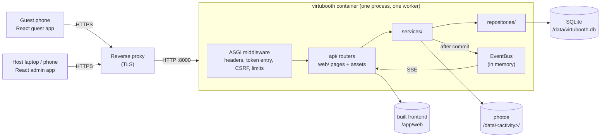
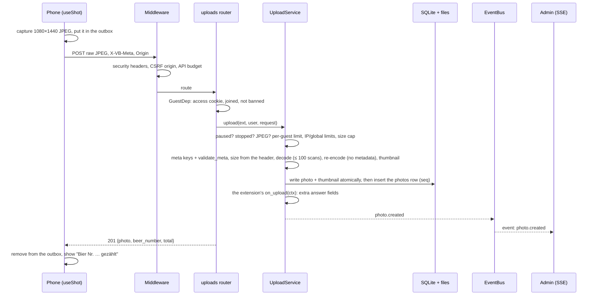
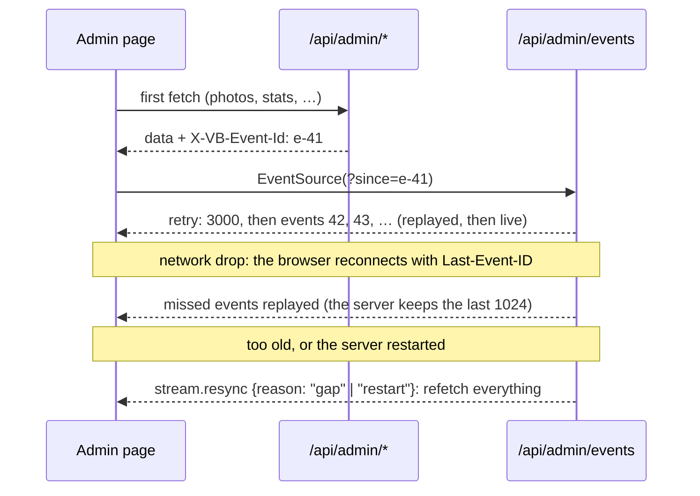
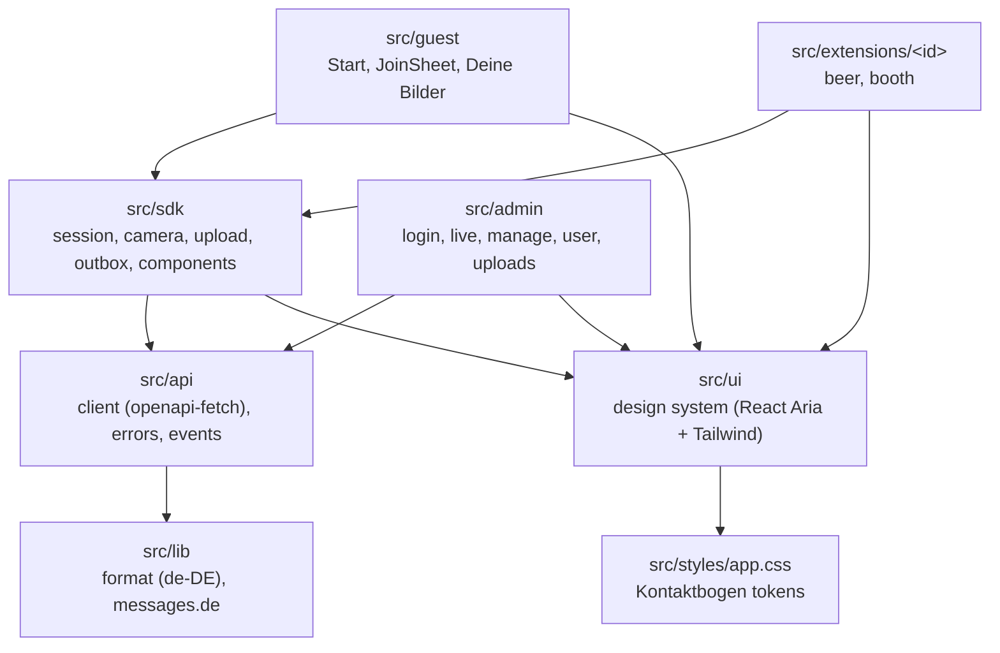
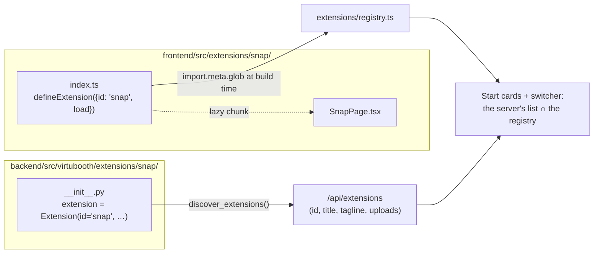

# virtubooth architecture

One process serves everything: a FastAPI app (one uvicorn worker) with the
JSON API, the photos, the admin event stream and the built React frontend.
State lives in SQLite plus photo files under `VB_DATA_DIR`. In production it
runs in Docker behind a TLS reverse proxy, because phones only open the
camera over HTTPS.



**One worker, on purpose.** Rate limits and the event bus live in process
memory. Never run several workers or replicas.

Contents:
[Backend](#backend) ·
[A request, end to end](#a-request-end-to-end) ·
[Transactions, audit, events](#transactions-audit-events) ·
[The admin event stream](#the-admin-event-stream) ·
[Web serving](#web-serving) ·
[Frontend](#frontend) ·
[Adding an activity](#adding-an-activity) ·
[Testing](#testing) ·
[Security model](#security-model) ·
[Stack](#stack)

## Backend

`backend/src/virtubooth/`, layered. Imports point downwards: a router never
touches SQL, and a repository never publishes an event.

| Layer | Path | What it does |
|---|---|---|
| Entry | `__main__.py` | CLI: `virtubooth serve` (default), `gen-env`, `export-openapi` |
| Composition | `app.py`, `runtime.py`, `settings.py` | `create_app(settings, extensions=None)` builds `Core` (settings, db, repos, services, bus, signer, limits, web, extensions), registers routers, error handlers and middleware. `Settings` is pydantic-settings over `VB_*`; secrets are `SecretStr`, and a bad value fails startup with the variable's name |
| core | `core/` | `errors.py` (`ErrorCode`, `ErrorBody`, `ApiError`), `security.py` (signing, cookies, origin check, security headers, client IP), `events.py` (`EventBus`, replay history), `ratelimit.py`, `logs.py` (token-masking access log), `clock.py` |
| db | `db/` | `Database`: one SQLite connection (WAL) behind a lock, nested transactions (savepoints), after-commit hooks, a WAL checkpoint when the app stops. `migrations.py`: numbered steps, append only |
| domain | `domain/` | dataclasses (`User`, `Photo`, …), constants (`PHOTO_WIDTH/HEIGHT` 1080×1440, id patterns, pause sources), pseudonyms |
| repositories | `repositories/` | one per aggregate: users, photos, bans, app_settings, admin_sessions, audit, exports, instagram, plus `admin_read_models` for the admin lists. SQL only |
| services | `services/` | the business logic and the only place that opens a write transaction: identity, uploads, moderation, upload_controls, admin_auth, exports (+ `export_runners.py`, one worker thread), instagram, images, views, `events.py` (typed admin events) |
| api | `api/` | `deps.py` (the access dependencies), `schemas/` (Pydantic `*In`/`*Out` models, `AdminEvent` union), `routers/` (guest, uploads, media, health, `admin/*`) |
| web | `web/` | serves the built frontend from `VB_WEB_DIR`: HTML entries, the gate/404 page, `/assets` (see [Web serving](#web-serving)) |
| extensions | `extensions/` | `sdk.py` (`Extension`, `UploadPolicy`, `UploadContext`, discovery) and one package per activity: `beer/`, `booth/` |
| tools | `tools/` | `qr`, `timelapse`, `export`: CLI tools (`python -m virtubooth.tools.<x>`) whose functions the admin's export jobs reuse |

Access levels are FastAPI dependencies from `api/deps.py`, used on every
route:

| Dependency | Needs | Fails with |
|---|---|---|
| `AccessDep` (`require_access`) | the `vb_access` cookie (an HMAC of the party token) | 404 `scan_qr` |
| `MeDep` | access + a joined guest (`vb_uid`, signed) that is not banned | 401 `needs_consent`, 403 `banned` |
| `GuestDep` | the same, for uploads | the same, with the upload wording |
| `AdminDep` | a live admin session (`vb_admin`, hashed in the DB) | 401 `admin_required` |

What was checked and fixed in the overhaul's security review (login lock,
CSRF origin rules, upload metadata, root-file allow-list, export contents) is
in [overhaul/SECURITY_REVIEW.md](overhaul/SECURITY_REVIEW.md).

Errors are always `ErrorBody {error: ErrorCode, message}` with a German
`message` the UI shows as-is. Every route declares a response model and its
error statuses, so `virtubooth export-openapi` writes a complete schema.
`frontend/openapi.json` is generated from it, and CI fails when it drifts.
The full contract is in [overhaul/contracts/api.md](overhaul/contracts/api.md).

The database tables are `users`, `user_fingerprints`, `fingerprint_bans`,
`photos`, `admin_sessions`, `audit_log`, `settings` (a small key/value store
for the upload and join switches and Instagram marks), `export_jobs` and
`visitors` (random browser ids for the dashboard's „Gescannt“). A schema
change is a new step appended to `db/migrations.py`; never edit a released one.

## A request, end to end

A Beer Cam upload, `POST /api/x/beer/upload`, from the phone to the admin's
screen:



1. **`SecurityHeadersMiddleware`** (outermost) adds the CSP and the other
   security headers to every answer.
2. **`GuardMiddleware`** (pure ASGI, `middleware.py`):
   - a `GET` with `?t=` is the token entry: valid → 303 to the same URL
     without `t` plus the access cookie, invalid → the gate page;
   - every `POST/PUT/PATCH/DELETE` must carry an `Origin` (or `Referer`)
     whose full origin (scheme, host, port) is `VB_PUBLIC_BASE_URL`'s, an
     entry of `VB_ALLOWED_ORIGINS`, or the request's own (the scheme uvicorn
     derived, https with a trusted `X-Forwarded-Proto`, plus `Host`). Behind
     a TLS proxy the app does not trust, `https://<Host>` also counts, but only
     when the proxy sends `X-Forwarded-Proto: https`, `VB_PUBLIC_BASE_URL` is
     https or `VB_COOKIE_SECURE=true`. `http://` origins are refused on https
     deployments. Anything else is 403 `bad_origin`;
   - JSON bodies need a `Content-Length` of at most 64 KiB;
   - `/api/*` counts against a request budget: per device for joined guests,
     per IP otherwise, none for a logged-in admin.
3. **The router** parses the request and resolves the access dependency, calls
   **one service** method and builds the response model. Routers stay thin.
4. **The service** owns the work and the transaction (next section).
5. Errors anywhere become `ApiError` → `ErrorBody` JSON. A 404 outside `/api`
   becomes the gate or not-found page.

## Transactions, audit, events

Services follow one pattern: the change, its audit entry and its event
commit together or not at all.

```python
def hide_photo(self, public_id: str, *, actor: str, reason: str = HIDDEN_BY_ADMIN) -> PhotoChange:
    with self.db.tx():  # BEGIN IMMEDIATE (a savepoint when nested)
        changed = self.repos.photos.hide(public_id, at=now_iso(), reason=reason)
        photo = self.repos.photos.get(public_id)
        if changed:
            self.repos.audit.log(actor, "photo.hide", f"photo:{public_id}", at=now_iso())
            if photo is not None:
                self.events.photo_hidden(AdminPhoto.of(photo))  # queued until COMMIT
    return PhotoChange(changed, photo)
```

- `Database.tx()` holds the connection lock, opens `BEGIN IMMEDIATE` (nested
  calls use savepoints), and rolls back on any exception.
- `AdminEvents._emit()` (`services/events.py`) does not publish right away. It
  registers `db.on_commit(...)`, so an event goes out only once the change is
  durable, and never for a rolled-back change.
- Files follow the same rule: a deleted photo's files are unlinked after the
  commit, so a failed transaction never loses a file the database still
  points to.
- The audit vocabulary (`photo.hide`, `user.ban`, `export.create`,
  `instagram.done`, …) is listed in [overhaul/contracts/api.md](overhaul/contracts/api.md).
  "Protokoll" in the admin shows it.

## Presence and online time

The dashboard's "Aktiv jetzt" and the per-guest online time come from two
cheap signals (`services/presence.py`, definitions in `domain/overview.py`):

- **Last seen.** Every guest API request passes `require_access`, which
  refreshes `users.last_seen_at` (or the visitor's, before joining), at most
  once per device and minute (an in-memory throttle).
- **The heartbeat.** `POST /api/here {visible}` (party access, no other
  answer than `{ok: true}`). The guest app (`frontend/src/sdk/presence.ts`)
  sends `{visible: true}` at start, every 60 s while
  `document.visibilityState` is `visible`, and at once when the page is shown
  again (never within 15 s of the last one). When the page is hidden or left
  (`visibilitychange`, `pagehide`) it sends `{visible: false}` once, as a
  `keepalive` fetch, which outlives the page and carries the Origin header the
  CSRF check needs. A 404 `scan_qr` stops it; other failures are silent.

Accounting, for a joined guest (signed `vb_uid` cookie), in one transaction:

| Beat | `online_at` set and at most 150 s old | otherwise |
|---|---|---|
| visible | `online_seconds += now - online_at` | `online_sessions += 1` (a new visit, nothing added) |
| hidden | `online_seconds += now - online_at` | nothing added |

Afterwards a visible beat sets `online_at = now`, a hidden one clears it, and
both set `last_seen_at = now`. So a visit ends when the page is hidden or
stops beating for 150 s (one lost beat is tolerated); `online_now` on
`AdminUser` is "`online_at` within 150 s". A browser that has not joined only
refreshes its visitor row (throttled).

- **Cost:** one small `UPDATE` per guest and minute; the beat's own request
  skips the throttled refresh and marks the device in the throttle, so other
  requests don't write again right away. 300 guests are about 5 writes a
  second, nothing for SQLite in WAL mode.
- **"Aktiv jetzt"** keeps its definition (not banned, seen in the last 5
  minutes), but since an open, visible page beats every minute, a guest who
  keeps the page open without doing anything now counts too. A phone that
  locks its screen or switches apps stops counting after 5 minutes.
- **Admin:** `AdminUser` carries `online_seconds`, `online_sessions` and
  `online_now` (the guests table's "Online" column); the user page gets
  `UserDetailOut.stats` (photos, hidden, deleted, per activity, first and last
  upload) from two aggregate queries. The archive's `users.csv` has
  `online_seconds` and `online_sessions`.
- The join texts tell guests that the hosts see this per-guest statistic.

## The admin event stream

`GET /api/admin/events` is Server-Sent Events. Each event has a type (for
example `photo.created`, `user.banned`, `settings.upload_pause`,
`export.updated`), a JSON payload and an id `<epoch>-<n>`. The epoch changes
with every server start.



- Every admin answer carries `X-VB-Event-Id`: the stream position before the
  request read anything. Opening the stream with `?since=` that id means
  nothing that happened in between is lost.
- A client that falls 256 events behind is disconnected. Its reconnect
  replays the rest. Logging out closes that session's streams at once (a bus
  signal); expiry and a password change are caught by a check every 30 s. The
  reconnect then gets 401 and the page goes to the login. One session holds
  at most 4 streams: a fifth closes the oldest, which reconnects and replays.
- A `: ping` comment goes out after 15 s without events, and the stream sends
  `X-Accel-Buffering: no` so proxies don't buffer it.
- Client side (`frontend/src/admin/store/`): `stream.ts` runs that life cycle,
  polls every 5 s while the stream is down, and resyncs when the tab becomes
  visible again. `applyEvent.ts` patches exact changes into the React Query
  cache and throttles refetches for everything else.

## QR codes and party access

A party has several QR codes, each with its own token (Admin → QR-Codes).
Code: `domain/codes.py` (rules), `repositories/codes.py`,
`services/codes.py` (`CodesService`), `api/routers/admin/codes.py`.

**Tables** (migration 5):

| Table | Holds |
|---|---|
| `party_codes` | one row per code: `id` (its number, `AUTOINCREMENT`, never reused), `animal` (the name is `"<animal> <id>"`, frozen), the current `token`, `token_gen` (+1 on every token change), `target` (`""` = Start, else an activity id), `note`, created/updated, `revoked_at`/`revoked_by` |
| `party_code_tokens` | every token a code ever had, as SHA-256 (the primary key): the current one has `retired_at` NULL. No token is ever handed out twice |
| `code_visitors` | `(code_id, visitor_id)`: which browser (`vb_vid`) opened which code, first/last time, how many scans |
| `users.code_id` | the code a guest joined through; set once at join, never changed |

Rows are never deleted: „Löschen“ revokes a code (`revoked_at`), its token
stops working, the row stays with its statistics. Names come from 100
animals that leave out the guest pseudonyms' animals (and every word
containing one); a new code gets a random animal among the least used ones.

**Seeding.** Migrations are SQL only, so `create_app()` calls
`CodesService.ensure_seeded()` right after `exports.recover()`: if
`party_codes` is empty, one transaction creates code 1 with
`VB_PARTY_TOKEN` (or a generated token), adopts everything from before
(`users.code_id = 1`, every `visitors` row into `code_visitors`), stores the
settings key `codes.seed` = `{token_sha256, at, source: "env"|"generated"}`
and audits `code.create` by `system`. A database whose codes are all revoked
is never seeded again. From then on the database is the only source of
tokens: when `VB_PARTY_TOKEN` is set and differs from the seeded one, the
startup log warns once that it no longer controls access.

**Scan** (`GuardMiddleware._token_entry`, any page `GET` with `?t=`): the
token is hashed and looked up among the current tokens of active codes
(hash-then-lookup: timing tells nothing about stored tokens). A hit sets
`vb_access`, counts the scan (`PresenceService.enter(code_id=…)` →
`code_visitors`) and redirects without `t`; a miss shows the gate. Wrong
tokens are limited per IP (`limits.token_fail_ip`, 60 per minute, IPv6 per
/64; valid scans are free): while an address' budget is empty, every token
gets the gate without being checked, so guessing gets no answer. The
trade-off: a guest who keeps guessing on the venue Wi-Fi blocks first scans
from that IP for as long as they keep it up.

**Access cookie.** `vb_access` = `signer.sign("access", "<code id>.<token_gen>")`.
`api/deps.py` `has_access()` (pages, `require_access`, media) asks
`CodesService.access_state()`:

| Cookie | Access |
|---|---|
| signed, its code active and still at that `token_gen` | yes |
| signed, its code revoked since or given a new token | only for a joined guest (`vb_uid` finds a user): joined guests keep their session, browsers that never joined must scan a valid code again |
| from before the codes (no `.`: `signer.mac("access", token)`, compared in constant time) | counts as code 1, generation 1: yes while code 1 is active and unchanged, else only for joined guests. Once code 1 has a new token, the old MAC is checked against `VB_PARTY_TOKEN` while that is still the seeded token |
| anything else | no (the gate, 404 `scan_qr` on the API) |

So revoking or re-tokening a code stops new scans and joins through it at
once; guests who joined stay until banned. There is no "lock everyone out"
switch any more: use bans, „Anmeldung stoppen“, revoking codes, and after the
party the volume wipe.

**Tokens.** Generated: `secrets.token_urlsafe(18)` (24 characters).
Custom: 16–128 of `[A-Za-z0-9_-]` (every token this app ever printed fits)
with at least 6 distinct characters; the limiter caps online guessing of
weaker hand-made ones. The audit log never holds a token, only `token_end`
(the last 4 characters).

**Attribution and statistics.** `POST /api/join` stores the code of the
request's access cookie (new or old format) on a new guest; re-joins and
later scans of other codes leave it alone. Per code (`CodeStats`, one query
for all codes): `scans` (sum of `code_visitors.scans`), `people`
(`code_visitors` rows), `guests` (`users.code_id`), `not_joined` (its
visitors without a user), `photos` (its guests' non-deleted photos),
`active_now` (its guests not banned and seen within 5 minutes),
`first_scan_at`/`last_scan_at`. Archives scrub `code_visitors` like
`visitors`; `party_codes` (with the tokens) stays in database copies.

**Admin API** (`/api/admin/codes`): list (with `base_url`), create, get,
`PATCH` (target, note), `POST …/token` (null = generate), `DELETE` (revoke;
`changed: false` when revoked already). Errors: `invalid_token`,
`token_taken` (409), `code_revoked` (409), `invalid_target`, `invalid_note`.
Every change is audited (`code.create`, `code.edit`, `code.token`,
`code.revoke`, target `code:<id>`) and sent as `code.changed`. The QR-Bogen
export job and `python -m virtubooth.tools.qr` use the active code with the
lowest number (the CLI also takes `--code N` or `--token`).

## Web serving

The backend serves the built frontend from `VB_WEB_DIR`: `/app/web` in the
image, `frontend/dist` of the checkout locally. Without it the server refuses
to start, unless `VB_DEV=1`, which serves placeholder pages for working with
`vite dev`. The contract is
[overhaul/contracts/web-serving.md](overhaul/contracts/web-serving.md).

| Path | Answer |
|---|---|
| `/`, `/x/<id>/…` | `index.html` with access, else the gate (404). Unknown activity → not found (404). `/x/<id>` → 308 to `/x/<id>/` |
| `/admin/login` | `admin.html`, public |
| `/admin/…` | `admin.html` with a session, else 303 to `/admin/login?next=…` |
| `/assets/*` | hashed files, `Cache-Control: public, max-age=31536000, immutable`; the `.br`/`.gz` sibling when the client accepts it |
| `/<file>` | only the allow-listed root files (`PUBLIC_ROOT_FILES`: `boot-check.js`, `gate-hint.js`, `icon.svg`, `favicon.ico`, `apple-touch-icon.png`, `robots.txt`), public, `max-age=300`. Every other root file, such as the HTML entries' `.br`/`.gz` siblings, is not found |
| anything else | the not-found page (404), or the gate without access |

- **One static file for both 404 pages.** `gate.html` contains both messages
  and `data-vb-mode="gate"` on `<html>`. For "not found" the server rewrites it
  to `notfound` and CSS shows the other block. It works without JavaScript.
- HTML (the entries, the gate, the not-found page) is `private, no-cache` with
  an ETag, and so are the page redirects; the `?t=` 303 that sets the access
  cookie is `no-store`. Paths are resolved inside the web dir only, and any
  dot segment is refused, so `.vite/manifest.json` is never served.
- A new file in `frontend/public/` that must be reachable needs an entry in
  `PUBLIC_ROOT_FILES` (`backend/src/virtubooth/web/frontend.py`).
- **Strict CSP on every answer**: `default-src 'self'; script-src 'self';
  style-src 'self'; img-src 'self' blob: data:; media-src 'self' blob:;
  connect-src 'self'; font-src 'self'; object-src 'none'; base-uri 'none';
  form-action 'self'; frame-ancestors 'none'`.

## Frontend

`frontend/`, React 19 + TypeScript + Vite, built as a multi-page app with
three entries. Details and conventions are in
[frontend/README.md](../frontend/README.md).

| Entry | App | Routes |
|---|---|---|
| `index.html` → `src/guest/main.tsx` | guest | `/` (Start), `/x/<id>/*` (an activity, loaded lazily) |
| `admin.html` → `src/admin/main.tsx` | admin | `/admin/login`, `/admin/live`, `/admin/manage?tab=…`, `/admin/user?id=…` |
| `gate.html` | none | static: "Scan den QR-Code" / "Hier ist nichts"; an optional script adds the in-app browser hint |

The guest and admin entries load `/boot-check.js` (a classic script) before
their module. If
the app never sets `window.__vbReady`, typically because a content blocker
dropped a chunk, it shows a German hint to turn the blocker off.



### The guest SDK (`src/sdk/`)

What every activity page builds on:

| Module | Gives you |
|---|---|
| `session.ts` | `useSession()`: `loading → needs_join → ready ⇄ banned` (or `error`), a zustand store. `canUpload(state)` says whether this guest may upload right now and why not ("Hochladen pausiert", "Hochladen ist kurz angehalten", "Gesperrt"). It re-identifies on focus, every 30 s while blocked, and after a refused upload |
| `camera/` | `useCameraSession()` wraps a `CameraSession`: getUserMedia with the iOS quirks handled, a WebGL1 renderer with a Canvas2D fallback, `capture()` that renders the 3:4 preview at exactly 1080×1440 (preview == photo), `switchFacing()`, mirroring only for the front camera. `CameraStage` (the `<video>` + canvas mount), `CameraErrorScreen` (German texts per camera error), `filters.ts` (the Fotobox shaders), `overlays.ts` (the Beer Cam outlines), `keys.ts` (Space = shutter, Esc) |
| `upload.ts` | `uploadPhoto(ext, blob, {meta, onProgress})`: XHR with progress, `X-VB-Meta`, German errors, `Retry-After` |
| `outbox.ts` | the shared IndexedDB outbox (`vb-booth`, store `outbox`): `addToOutbox`, `flushOutbox`, `useOutbox()`. Photos wait on the device until the server has them |
| `camera/useShot.ts` | `useShot(ext)`: one photo's life, from capture → outbox → upload with progress → result (`uploading`, `done`, `waiting`, `held`, `failed`), with `take`, `retry`, `dismiss` |
| `components/` | `ActivityShell` (the camera page frame: title, guest pass, 3:4 stage, film edge, hint, controls, the toast slot), `ActivityMenu` (the switcher), `GuestPass` + `GuestSheet` (the "Du" sheet), `StatusSlot` |
| `feedback.ts`, `share.ts`, `platform.ts`, `debug.ts`, `device.ts` | vibrate/flash, `saveImage()` (the iOS share sheet, a download elsewhere), `isIOS`/`isInAppBrowser`, the `?debug=1` panel, the device traits |

### The design system (`src/ui/`, `src/styles/app.css`)

"Kontaktbogen" ([overhaul/design/DESIGN.md](overhaul/design/DESIGN.md)):
every photo is a frame on the party's film roll. Guests and the live screen
work in a darkroom (Rotlicht `#2b0f0c` with the Safelight amber `#ffa630`).
Verwaltung and the guest page are a light table (Leuchttisch) with grease-pencil
marks: X = hidden, circle = selected. The signature element is the film edge
(`FilmEdge`), whose sprocket holes double as the upload progress bar. Fonts
are Bricolage Grotesque and Doto (numerals only).

- Tokens live in `app.css` as Tailwind 4 `@theme` variables: the palette,
  semantic colours per surface (`data-surface="dark|light"`), the type scale,
  radii, z-layers and motion durations. `contrast.test.ts` checks 34 colour
  pairs against WCAG AA.
- `src/ui/` holds presentational components only (no API calls): React Aria
  Components styled with Tailwind and `tailwind-variants`, for example
  `Button`, `Sheet`, `ConfirmDialog`, `Toast` (one slot), `Switch`,
  `SegmentedControl`, `DataTable`, `PhotoTile`, `FilmEdge`, `Shutter` and
  `Countdown`. A dev-only gallery shows them all (`pnpm dev`, then `/__ui`).
  It never ships.

### The API client (`src/api/`)

`schema.gen.ts` is generated from `frontend/openapi.json` (`pnpm gen:api`),
which is exported from the backend (`make openapi` does both). `client.ts`
wraps openapi-fetch: paths, bodies and answers are typed, and `unwrap()` turns
every failure into an `ApiError` (`status`, `code`, German `message`,
`retryAfter`, `offline`). `scan_qr` reloads the page, so the gate shows.
`types.ts` gives the generated shapes friendly names (`GuestUser`,
`AdminPhoto`, …); import types from there. `events.ts` types the admin event
stream.

## Adding an activity

An activity, such as the Beer Cam or the Fotobox, is an **extension**: a
backend package and a frontend folder with the same id. Core already does
everything else:

| You write | Core gives you |
|---|---|
| `Extension(...)` in `backend/src/virtubooth/extensions/<id>/__init__.py` | discovery and `VB_EXTENSIONS`; `POST /api/x/<id>/upload` with access, join, ban and pause checks, rate limits, JPEG validation, re-encoding, thumbnails, storage under `data/<id>/`, sequence numbers and the `photo.created` event; your router at `/api/x/<id>/`; the card on Start; the QR code on the QR sheet; the activity in the admin (filters, meta labels, Instagram ZIP, archive, timelapse) |
| a page in `frontend/src/extensions/<id>/` | the route `/x/<id>/` behind the gate and the join sheet, a lazily loaded chunk, the activity switcher, "Deine Bilder", the guest pass, the outbox, the film edge and every design-system component |



The guest app shows an activity when **both** halves exist: the server lists
it (`GET /api/extensions`, filtered and ordered by `VB_EXTENSIONS`) and the
build has a page for it (`registry.ts`). A unit test
(`test_frontend_contract.py::test_extension_folders_match_the_backend`) fails
when one half is missing.

An extension can also bring admin routes: `Extension.admin_router` is mounted
at `/api/admin/x/<id>/` behind the admin session check (the Fotobox keeps its
filter switches there, stored as `x.booth.filters` in the `settings` table, and
announces changes with the `extension.settings` event).

### A complete example: "Schnappschuss"

The smallest useful camera activity: one photo, no frills. This exact code
was built and tested (Chromium, fake camera: the photo uploads, 1080×1440,
zero console errors).

**1. Choose an id.** It must match `^[a-z][a-z0-9-]{1,30}$`, and it is the
package name, the frontend folder, the URL (`/x/snap/`) and the photo folder
(`data/snap/`). Keep it neutral for content blockers: no `ad`, `ads`,
`track`, `banner`, `pixel` or similar.

**2. The backend: `backend/src/virtubooth/extensions/snap/__init__.py`.**

```python
"""Schnappschuss: one photo, nothing else. The smallest camera activity."""

from typing import Any

from virtubooth.domain.constants import FACINGS, PHOTO_HEIGHT, PHOTO_WIDTH
from virtubooth.extensions.sdk import Extension, UploadPolicy


def validate_meta(meta: dict[str, Any]) -> dict[str, Any]:
    if meta.get("facing") not in FACINGS:
        raise ValueError("Unbekannte Kamera.")  # → 400 invalid_meta, shown to the guest
    return {"facing": meta["facing"]}


extension = Extension(
    id="snap",
    title="Schnappschuss",
    emoji="📷",
    tagline="Ein Foto, sonst nichts.",
    upload=UploadPolicy(
        max_side=PHOTO_HEIGHT,
        min_side=480,
        exact_size=(PHOTO_WIDTH, PHOTO_HEIGHT),  # 1080×1440, like Beer Cam and Fotobox
        meta_keys=frozenset({"facing"}),
        validate_meta=validate_meta,
    ),
    order=30,
    meta_labels={"facing": "Kamera"},
)
```

- `upload` makes it a photo activity. Without it the activity takes no
  uploads (`uploads: false` in `/api/extensions`).
- `UploadPolicy`: `exact_size` (every photo must have it), `max_side`,
  `min_side`, `quality` (re-encode, default 85), `thumb_side` (400),
  `max_bytes` (default `VB_MAX_UPLOAD_BYTES`), `meta_keys` (the only keys the
  client may send in `X-VB-Meta`) and `validate_meta` (raise
  `ValueError("<German message>")` to refuse with 400 `invalid_meta`).
- `order` sorts the activities when `VB_EXTENSIONS` is empty. `meta_labels`
  names the meta keys in the admin inspector. `show_on_home=False` hides the
  card and the QR code.
- The `emoji` appears only on the QR sheet; the UI uses Lucide icons.

**3. The frontend registration: `frontend/src/extensions/snap/index.ts`.**

```ts
import { defineExtension } from '@/sdk/extension';

/** Schnappschuss: one photo, nothing else. */
export default defineExtension({ id: 'snap', load: () => import('./SnapPage') });
```

`registry.ts` collects every `src/extensions/*/index.ts` at build time
(`import.meta.glob`) and checks that the folder name equals the `id`. `load`
keeps the page in its own chunk, which loads only on `/x/snap/`.

**4. The page: `frontend/src/extensions/snap/SnapPage.tsx`.**

```tsx
import { t } from '@/lib/messages.de';
import { STREAM_SIZE } from '@/sdk/camera/capture';
import { CameraErrorScreen } from '@/sdk/camera/CameraScreens';
import { CameraStage, PREVIEW_CANVAS_CLASS } from '@/sdk/camera/CameraStage';
import { useCameraSession } from '@/sdk/camera/useCameraSession';
import { useShot } from '@/sdk/camera/useShot';
import { ActivityMenu } from '@/sdk/components/ActivityMenu';
import { ActivityShell } from '@/sdk/components/ActivityShell';
import { GuestPass } from '@/sdk/components/GuestPass';
import type { ExtensionPageProps } from '@/sdk/extension';
import { canUpload, useSession } from '@/sdk/session';
import { Button } from '@/ui/Button';
import { FilmEdge } from '@/ui/FilmEdge';
import { Shutter } from '@/ui/Shutter';

const TITLE = 'Schnappschuss';

export default function SnapPage({ id }: ExtensionPageProps) {
  const session = useSession();
  const gate = canUpload(session); // paused, stopped or banned: say so before the shot
  const {
    videoRef,
    mountRef,
    session: camera,
    camera: cam,
  } = useCameraSession({
    enabled: session.status === 'ready', // the camera prompt never comes before joining
    facing: 'user',
    ...STREAM_SIZE.booth,
    canvasClassName: PREVIEW_CANVAS_CLASS,
  });
  const { shot, take, dismiss } = useShot(id); // outbox first, then the upload
  const live = cam.status === 'live' && cam.ready;

  const shoot = async () => {
    if (!camera || !live || !gate.ok) return;
    const blob = await camera.capture(); // exactly the 1080×1440 preview
    await take(blob, { facing: cam.facing }); // the X-VB-Meta the backend validates
  };
  const again = async () => {
    dismiss();
    await camera?.resume();
  };

  return (
    <ActivityShell
      heading={TITLE}
      title={<ActivityMenu currentId={id} title={TITLE} />}
      topRight={<GuestPass compact />}
      stage={
        <CameraStage videoRef={videoRef} mountRef={mountRef} ready={live || !!shot}>
          {shot ? (
            
          ) : null}
        </CameraStage>
      }
      filmEdge={
        <FilmEdge
          label="Foto"
          {...(shot?.result ? { frame: shot.result.photo.seq } : {})}
          state={shot?.status === 'uploading' ? 'uploading' : shot?.status === 'done' ? 'done' : 'idle'}
          progress={shot?.progress ?? 0}
          progressLabel={t.uploading}
        />
      }
      hint={<p>{gate.ok ? 'Lächeln!' : gate.message}</p>}
      controls={
        shot ? (
          <Button variant="primary" size="lg" block onPress={() => void again()}>
            {t.newPhoto}
          </Button>
        ) : (
          <>
            <span aria-hidden="true" className="size-12" />
            <Shutter
              state={!live ? 'not-ready' : gate.ok ? 'ready' : 'blocked'}
              onPress={() => void shoot()}
            />
            <span aria-hidden="true" className="size-12" />
          </>
        )
      }
      controlsLayout={shot ? 'actions' : 'camera'}
      holdLayout={!!shot}
    >
      {cam.status === 'error' && cam.error ? <CameraErrorScreen error={cam.error} /> : null}
    </ActivityShell>
  );
}
```

What the page gets without writing it:

- It renders inside the guest app's session gate: the guest has joined, and
  banned guests never get here. The join sheet, the gate and errors are
  handled before the page mounts.
- `useShot` puts the photo into the outbox **before** uploading. A dead
  network, a reload or a closed tab never loses it: the outbox sends it later
  by itself (the guest pass shows that photos wait). Add
  `useOutboxToasts(shot?.id ?? null)` for a toast when a waiting photo gets
  through, and `retry` from `useShot` for an "Erneut senden" button, like the
  Beer Cam.
- `ActivityShell` gives the camera layout for phones, short screens,
  landscape and desktop, keeps the stage 3:4 (the stage is the photo), and
  places the single toast slot above the controls. The camera control row has
  three slots, `[left] [shutter] [right]`; the spacers keep the shutter
  centred.
- `CameraErrorScreen` explains a denied permission, a missing camera or an
  in-app browser in German.

**5. Update the two tests that list the activities.** They pin the set on
purpose: `frontend/src/extensions/registry.test.ts` (`['beer', 'booth',
'snap']`) and `backend/tests/api/test_core_access.py::test_discover_respects_explicit_order`.

**6. Run it.**

```bash
make build-web && make dev        # or: make dev + make dev-web for hot reload
make lint typecheck test          # the contract test checks that both halves exist
```

Open `/?t=<token>`: Start shows a "Schnappschuss" card with its tagline, and
the switcher lists it. The activity is on by default; with `VB_EXTENSIONS`
set, add its id there (`VB_EXTENSIONS=beer,booth,snap`), which also sets the
order. The admin shows its photos with an "Aktivität" filter, the QR sheet
gets a `qr-snap` code, and the archive export puts its photos under
`photos/snap/`. Its OpenAPI schema does not change, because uploads go
through the shared route.

### Going further

All of these are optional. Beer Cam (`extensions/beer/`) and Fotobox
(`extensions/booth/`) are the complete references.

- **Your own API.** Pass `router=APIRouter()` and protect every route with a
  dependency from `virtubooth.api.deps`. It is mounted at `/api/x/<id>/`.
  Beer Cam's counter:

  ```python
  @router.get("/stats", dependencies=[Depends(require_access)])
  def stats(core: CoreDep) -> BeerStats:
      """The counter. Party access is enough (no join needed)."""
      return BeerStats(total=total_beers(core), goal=GOAL)
  ```

  Read through repositories (`core.repos.photos.count(EXT_ID, hidden=False)`).
  Anything that writes belongs in a service, inside `db.tx()`, with an audit
  entry.
- **Extra fields in the upload answer.** `on_upload(ctx: UploadContext)`
  runs after the photo is stored (`ctx.core`, `ctx.user`, `ctx.photo`), and
  its dict is merged into the 201 answer. Declare the fields with
  `upload_result=<a Pydantic model>` so the schema's `UploadOut` has them
  (Beer Cam: `beer_number`, `total`). Then run `make openapi` and commit
  `frontend/openapi.json` and `src/api/schema.gen.ts`.
- **A server-side catalogue.** Fotobox keeps its filter list in
  `extensions/booth/filters.json`, serves it at `GET /api/x/booth/filters`,
  and `validate_meta` accepts only ids listed there. Filters themselves are
  WebGL1 shaders in `frontend/src/sdk/camera/filters.ts`, with a Canvas2D
  fallback. Never use CSS filters or `ctx.filter`: the saved photo must be
  the shader's output.
- **Overlays** in photo coordinates: an SVG with `viewBox="0 0 1080 1440"`
  over the stage, like the Beer Cam outline (`sdk/camera/overlays.ts`). It is a
  guide, not part of the photo.
- **A nicer presence in the guest app:** a live line on the Start card (the
  optional lazy `card` slot of `defineExtension`, like the beer counter in
  `extensions/beer/BeerCard.tsx`), an icon
  in the switcher (`ICONS` in `src/sdk/components/ActivityMenu.tsx`; the
  default is a camera), and a frame word (`FRAME_WORD` in `src/lib/format.ts`:
  "Bier 0032", "Foto 0018"; otherwise the capitalised id, "Snap 0001").
- **e2e tests** go in `backend/tests/e2e/activities/`. The harness gives you a
  phone with fake front and back cameras, `join_via_api(page, live)` for a
  joined guest, and fails on any console error. Port the patterns of
  `test_beer_e2e.py` and `test_booth_e2e.py`.
- **An activity without uploads**, such as a Live Wall for a TV, leaves out
  `upload` and brings its own router. The admin event stream is admin-only,
  so a wall would add its own read-only endpoint.

### Rules for activity code

- **CSP:** no inline `<style>` or `<script>`, no `eval`, no
  `dangerouslySetInnerHTML`, no `setAttribute('style', …)`. React's
  `style={{…}}` is fine (it goes through the CSSOM), but classes and tokens
  are better. New npm packages must pass the browser check against a built
  `dist` (`frontend/scripts/browser-check.py`).
- **Neutral names** in files, CSS classes, ids, test ids and storage keys
  (`pnpm build` fails otherwise).
- **German copy** from `src/lib/messages.de.ts` (the glossary: "Hochladen",
  "Erneut senden", "Neues Foto", …) and numbers through `src/lib/format.ts`
  (de-DE, NBSP before units).
- **Design tokens only**: no new colours, sizes or radii. Photos have square
  corners and real `width`/`height`.
- **Camera rules:** capture exactly what the preview shows, at 1080×1440;
  mirror only the front camera; ask for the camera only after joining.

## Testing

| Suite | Where | Run |
|---|---|---|
| unit + API | `backend/tests/unit`, `backend/tests/api` (TestClient, stub web dir in `tests/fixtures/web`) | `make test` or `cd backend && uv run pytest -q` |
| frontend unit | `frontend/src/**/*.test.ts(x)`, Vitest + Testing Library on happy-dom | `make test` or `cd frontend && pnpm test` |
| e2e | `backend/tests/e2e/{guest,activities,admin}`, Playwright against a live server serving `frontend/dist` | `make e2e`, `make e2e-firefox`, `make e2e-webkit`, `make e2e-changed` |
| content blockers | `scripts/check-names.mjs` (build), `tests/unit/test_core_blockers.py`, `tests/e2e/guest/test_blockers_e2e.py` | `make build-web`, `make test`, `VB_BLOCKLISTS=.blocklists` for the full lists |
| container | `scripts/docker-smoke.sh` + `scripts/smoke.py` | `make docker-smoke` |

Backend fixtures (`backend/tests/conftest.py`): `settings` (never from the
shell's `VB_*`), `app`, `core`, `client`, `guest(instagram=…)` (a joined guest
client), `admin` (a logged-in client); override `extensions` in a module to
load real ones. The e2e fixtures (`backend/tests/e2e/conftest.py`): `live` (the
server: `.url()`, `.entry()` = the QR URL, `.core`), `page`, `admin_page`,
`new_context(browser, "phone" | "desktop")`, `join_via_api`, `track_errors`,
`wait_until_ready` and `shot` (screenshots into `VB_SCREENSHOT_DIR`).
Browser-specific skips are marked `chromium_only`, `firefox_only` and
`needs_clipboard`. `VB_FAKE_VIDEO=clip.y4m` swaps in your own camera clip.

What the suites cover:

- **Unit and API tests** (`backend/tests/unit`, `backend/tests/api`): the
  whole HTTP API through FastAPI's TestClient, the migrations, the tools, the
  OpenAPI export, the web serving contract. **Vitest** (`frontend/src/**/*.test.ts(x)`):
  the SDK (session state machine, outbox, upload, camera crop math), the API
  error mapping, formatting, contrast of the colour tokens, key components.
- **End to end** (`backend/tests/e2e`): pytest drives Playwright against a live
  server that serves the **built** `frontend/dist`. Phones get fake front and
  back cameras, desktops a webcam. Every test ends with zero console errors,
  which also catches CSP violations. Pick the browser with
  `VB_E2E_BROWSER=chromium|firefox`, or run WebKit (Safari's engine) with
  `backend/tests/e2e/run_webkit.sh` in `mcr.microsoft.com/playwright/python:v1.63.0-noble`.
  Extra pytest arguments: `make e2e E2E_ARGS="-k beer -x"`.
- **Speed.** The suites run in parallel with pytest-xdist (`make test`: 4 workers,
  `make e2e*`: `E2E_WORKERS=4`, CI the same; `0` = one process). Each e2e test has its
  own server (`live`: a fresh data directory and a port bound before the server starts,
  so workers never collide); each worker has one browser and a fresh context per test.
  The harness re-checks waiting `expect()`s and `wait_for()`s every 100 ms instead of
  Playwright's 500 ms (`tests/e2e/fastpoll.py`; `VB_E2E_SLOW_POLL=1` turns it off).
  With 4 workers the whole suite takes about 2 min in Chromium and Firefox and 2.5 min
  in WebKit (serially 8 to 10 min), at 0.8 to 1 GB of RAM per worker. The e2e targets
  rebuild `frontend/dist` only when a file in `frontend/` changed.
  `make check` is the everyday gate (lint, typecheck and tests side by side, then
  Chromium e2e); `make check-all` adds Firefox, WebKit and the Docker smoke test.
- **Content-blocker audit.** uBlock, AdGuard, Brave and iOS blockers drop URLs
  and hide elements that look like ads, tracking or cookie notices, which can
  silently break a page. Names stay neutral everywhere, and three checks keep
  them so: `pnpm build` fails on blocker-prone file names and CSS selectors
  (`scripts/check-names.mjs`); `tests/unit/test_core_blockers.py` matches
  every URL (and `frontend/public`, the HTML entries and the source paths)
  against a vendored set of real filter rules; and the e2e suite scans the
  rendered pages (every main screen of the guest app, the activities and the
  admin). For the full lists (about 40 MB, downloaded once):
  `cd backend && VB_BLOCKLISTS=.blocklists uv run pytest tests/unit/test_core_blockers.py`
  (the same variable feeds the e2e scans).
- **Docker smoke** (`scripts/docker-smoke.sh`): runs the image like
  `compose.yaml` does (read-only, no capabilities, fresh volume and secrets)
  and checks the image (USER 10001, no `VB_DEV`, no `.env`), the gate, the
  token entry, hashed and precompressed assets, the root-file allow-list, the
  CSP, a guest joining and uploading, the admin login and event stream, one
  export job of each kind, the CLI tools and a clean stop.

## Security model

What protects a party, layer by layer.

- **Party token.** Everything a guest sees needs the token from the QR code.
  A valid `?t=` sets an HttpOnly access cookie (an HMAC of the token, 30 days)
  and redirects to the same URL without the token. The access log masks it,
  and pages send `Referrer-Policy: no-referrer`. Rotating `VB_PARTY_TOKEN`
  locks every guest out until they scan a new code.
- **Guest identity without accounts.** Joining creates a pseudonymous guest
  pinned to the device by a signed cookie, plus a localStorage copy. Device
  traits are stored as a moderation **hint**, never as an identity:
  identical phones often look the same.
- **Admin.** A password from the environment: at least 12 characters, and
  use 16+ random ones (`gen-env` makes one; the log warns at startup when it
  is shorter than 16 characters or very repetitive). The session is a random
  token stored hashed, in a `SameSite=Strict` cookie that expires
  (`VB_ADMIN_SESSION_HOURS`, 12 h; log in before the guests arrive).
- **Admin login lock.** Login is rate limited per IP (5 per minute, 20 per
  hour; IPv6 per /64). After 20 wrong passwords within 15 minutes from
  anywhere, **every** login is refused for 5 minutes (429 with `Retry-After`,
  "Zu viele Fehlversuche"), the correct password too, so spreading guesses
  over many addresses gains nothing. Admins who are logged in keep working.
  To get in during a lock, wait, or restart the container (`docker compose
  restart app`; the counters live in memory). A login sent from the server
  itself straight to the app's port (no proxy) is exempt. See
  [DEPLOY.md](DEPLOY.md#locked-out-of-the-admin-login).
- **Every state-changing request** passes a CSRF check of the full origin
  (scheme, host and port: `VB_PUBLIC_BASE_URL`, `VB_ALLOWED_ORIGINS` or the
  request's own; `http://` origins are refused on https deployments), a body
  size cap, and per-device, per-IP and global rate limits.
- **Uploads** are validated (JPEG only, the activity's exact size, at most
  100 scans, byte caps) and re-encoded, so all metadata is stripped
  (EXIF/GPS, XMP, ICC, comments) and never reaches the disk. Photos are stored
  outside the web root, and a photo is served only to its guest and the
  admin.
- **Pages.** Without the party cookie only the gate and a short allow-list of
  root files (`boot-check.js`, icons, `robots.txt`) are served. HTML is
  `private, no-cache`; the token redirect is `no-store`.
- **Strict CSP**: `script-src 'self'; style-src 'self'`, no inline scripts or
  styles, no external hosts, plus `X-Frame-Options: DENY`, COOP/CORP and a
  Permissions-Policy that allows only the camera. A pnpm patch removes the
  two runtime `<style>` injections of React Aria that the CSP would block.
- **Container.** Runs as uid 10001 on a read-only root filesystem, without
  Linux capabilities and with `no-new-privileges`, CPU/memory/PID limits and
  a health check. Everything it writes is in the `/data` volume.
- **Exports.** The database copy in the admin's archive and in the CLI
  export holds guests with IPs, fingerprints and bans, all photo rows and the
  audit log, but no admin sessions and no export jobs, and it is vacuumed so
  nothing deleted earlier can be recovered.
- **Retention.** Hidden photos stay on disk; only deleting removes files.
  After the party, export what you keep and delete the volume
  ([DEPLOY.md → Teardown](DEPLOY.md#teardown)).
- The full security review of the overhaul, with what was fixed and what was
  accepted: [overhaul/SECURITY_REVIEW.md](overhaul/SECURITY_REVIEW.md).

### The admin password

- **Where it lives.** Until the host changes it, the password is
  `VB_ADMIN_PASSWORD`, compared in constant time. Changing it in the admin
  (`POST /api/admin/settings/password`) or with `virtubooth
  reset-admin-password` stores `admin.password` in the `settings` table: a
  scrypt hash (stdlib `hashlib.scrypt`, n = 2^15, r = 8, p = 1, 16-byte salt,
  encoded `scrypt$15$8$1$<salt>$<hash>`; `core/passwords.py`). While it exists
  it is the only valid password. `VB_ADMIN_PASSWORD` stays required: it is the
  first password and what `reset-admin-password --from-env` goes back to.
- **Session tag.** Every session stores a tag of the password it logged in
  with: an HMAC of the stored hash (new salt per change, so a new tag), or of
  the env password while no hash is stored (as before, so existing sessions
  survived the update). The session check reads the settings row on every
  request, never a cache, so a reset from the CLI (another process) applies at
  once.
- **Change.** Needs the current password and shares the login's limits (per-IP
  budget, global lock). A wrong current password is audited
  (`admin.password_change_failed`) and counts as a failed login; the answer is
  403 `wrong_password`, because the admin client reads 401 as "logged out". One
  transaction stores the hash, re-tags the session that asked, deletes every
  other session and writes the audit entry; after the commit the bus closes the
  other sessions' event streams.
- **Reset.** `virtubooth reset-admin-password` (`tools/admin_password.py`)
  works on the database directly: `--from-env` deletes the hash, otherwise it
  stores a new one (asked twice, or `--password-stdin`). It always deletes every
  admin session (open streams end at their next 30 s session check) and audits
  `admin.password_reset` by `cli`.

## Stack

The versions the project pins. The lockfiles (`backend/uv.lock`,
`frontend/pnpm-lock.yaml`) are the source of truth.

| Area | What (pinned versions) |
|---|---|
| Backend | Python 3.14 (3.12+ works), FastAPI 0.143, Pydantic 2.14 + pydantic-settings 2.15, uvicorn 0.54 (one worker), SQLite (stdlib `sqlite3`, WAL), Pillow 12.3, segno 1.6 (QR), ffmpeg (timelapse) |
| Frontend | React 19.3 with the React Compiler, TypeScript 6.0 (strict), Vite 8.3 (multi-page, Rolldown), Tailwind CSS 4.3 + tailwind-variants, react-aria-components 1.22, TanStack Query 5, wouter 3, zustand 5, zod 4 (`zod/mini`), lucide-react, Bricolage Grotesque + Doto (self-hosted) |
| API client | openapi-typescript 7.13 + openapi-fetch 0.17, generated from the backend's OpenAPI export |
| Tooling | uv 0.12, pnpm 11.28 on Node 22.22, ruff 0.17, mypy 2.4 (strict), oxlint 1.87 (type-aware) + Prettier 3.9 |
| Tests | pytest 9, Vitest 5 + Testing Library (happy-dom), Playwright 1.63 (Chromium, Firefox, WebKit) |
| Runtime | Docker image: `python:3.14.8-slim-trixie` + ffmpeg, built with `node:22.22.1-trixie-slim`; Compose and Coolify files |
