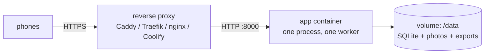

# Deploying virtubooth

This guide takes virtubooth from a Linux server with Docker to a party-ready
HTTPS site. It covers Compose, Coolify, the reverse proxy, every setting,
backups, updates, the exports and troubleshooting. How the pieces fit:
[ARCHITECTURE.md](ARCHITECTURE.md).



> **One container, one worker.** Rate limits and the live event bus are kept
> in memory. Never scale the service, add replicas or run more workers: a
> PaaS "scale" button would break the live screens and the rate limits.

Contents:
[Requirements](#requirements) ·
[The image](#the-image) ·
[Docker Compose](#docker-compose) ·
[Reverse proxy and HTTPS](#reverse-proxy-and-https) ·
[Coolify](#coolify) ·
[Settings](#settings) ·
[Party-night checklist](#party-night-checklist) ·
[Exports](#exports) ·
[Backups](#backups) ·
[Updating](#updating) ·
[Rotating secrets](#rotating-secrets) ·
[Locked out of the admin login](#locked-out-of-the-admin-login) ·
[Logs and monitoring](#logs-and-monitoring) ·
[Teardown](#teardown) ·
[Troubleshooting](#troubleshooting)

## Requirements

- A Linux server with **Docker Engine 25+** and the **Compose plugin**
  (`docker compose version`). 1 vCPU and 1 GB RAM are plenty for about 50
  guests at runtime.
- **Building the image** needs about 1 GB of free RAM for a minute, because
  the frontend is built inside it (Node). On a 1 GB server, add swap or build
  the image elsewhere and push it to a registry (`VB_IMAGE`).
- Disk: the image is about 900 MB (236 MB to download). Photos take up to
  about 0.5 MB each with their thumbnail, so 1 GB holds at least 2000 of them.
  Export files come on top.
- A domain (e.g. `party.example.com`) with an A/AAAA record pointing at the
  server, and ports 80 and 443 open for the proxy's certificates.

## The image

The root `Dockerfile` builds one self-contained image in three stages:

| Stage | Base | Does |
|---|---|---|
| `web` | `node:22.22.1-trixie-slim` (= `frontend/.node-version`) | installs pnpm 11.28.5 with npm, `pnpm install --frozen-lockfile` (with the React Aria CSP patch from `frontend/patches/`), `pnpm build`: hashed assets, `.br`/`.gz` siblings, the content-blocker name check |
| `build` | `python:3.14.8-slim-trixie` + uv 0.12.18 | `uv sync --frozen --no-dev` of `backend/` into `/opt/venv` |
| `runtime` | `python:3.14.8-slim-trixie` + ffmpeg | `/opt/venv`, the built frontend in `/app/web` (`VB_WEB_DIR`), a user with uid/gid 10001, the volume `/data`, a health check on `/healthz` |

Neither Node, uv, the sources nor the tests end up in the runtime image.
`.dockerignore` is an allowlist: only `backend/` (lockfile, metadata, `src/`)
and the frontend sources the build reads go into the build context. `.env`,
data, `node_modules` and local builds never do.

```bash
docker build -t virtubooth:local .     # what `docker compose build` does
make docker-smoke                      # build + run on 127.0.0.1:8180 + check end to end
```

## Docker Compose

### 1. Get the code onto the server

```bash
git clone <your repo url> ~/virtubooth && cd ~/virtubooth
```

Or copy it from your machine without local junk:

```bash
rsync -a --exclude .git --exclude .venv --exclude node_modules --exclude dist \
  --exclude .worktrees --exclude data --exclude .env ./ server:virtubooth/
```

### 2. Configure

```bash
cd ~/virtubooth
docker compose run --rm -T app virtubooth gen-env > .env   # builds the image, prints fresh secrets
chmod 600 .env
$EDITOR .env
```

The first run prints "pull access denied for virtubooth" before it builds the
image; that is expected. Set at least:

```dotenv
VB_PARTY_NAME="Lenas 30."
VB_INSTAGRAM_ACCOUNT=@lenas30
VB_PUBLIC_BASE_URL=https://party.example.com
VB_COOKIE_SECURE=true
VB_FORWARDED_ALLOW_IPS=172.16.0.0/12   # see "Reverse proxy and HTTPS"
VB_PUBLISH_PORT=127.0.0.1:8000         # proxy on this host; for a proxy in Docker, see Traefik below
```

`compose.yaml` pins `VB_DATA_DIR=/data`, `VB_HOST=0.0.0.0`, `VB_PORT=8000`
and `VB_WEB_DIR=/app/web` inside the container, whatever `.env` says. Quote
values with spaces (`"Lenas 30."`). Compose expands `$` in `.env` values, so
keep `$` out of passwords or wrap the value in single quotes.

### 3. Start

```bash
docker compose up -d --build
docker compose ps                         # STATUS shows "(healthy)" after a few seconds
curl -fsS http://127.0.0.1:8000/healthz   # {"ok":true}
docker compose logs -f app                # Ctrl-C to stop following
```

| Task | Command |
|---|---|
| Status / health | `docker compose ps` |
| Logs | `docker compose logs -f app` |
| Stop (keeps data) | `docker compose stop`, or `down` (also removes the container) |
| Apply `.env` changes | `docker compose up -d` (a plain `restart` does **not** re-read `.env`) |
| Shell inside the container | `docker compose exec app sh` |
| Remove everything including photos | `docker compose down -v` (irreversible) |

What the container does:

- runs as uid/gid 10001 with a read-only root filesystem, no Linux
  capabilities, `no-new-privileges`, CPU/memory/PID limits and a small init
  process;
- keeps everything in the named volume `virtubooth_data` at `/data`, which
  survives `down`, rebuilds and updates (only `down -v` deletes it);
- has a health check on `GET /healthz`, rotates its logs (5 × 10 MB), and
  stops within seconds (open live streams are closed after 5 s).

## Reverse proxy and HTTPS

Phones only allow the camera on HTTPS pages, so the proxy is not optional.
Whatever you use, it must:

1. **Terminate TLS** for your domain.
2. **Pass the original `Host` header.** The CSRF check compares the
   browser's `Origin` (scheme, host and port) with `VB_PUBLIC_BASE_URL` and
   with the request's own origin; set `VB_PUBLIC_BASE_URL=https://<your-domain>`
   in any case. Behind TLS it accepts `https://<host>` (the public URL, the
   request's own origin, or `https://<Host>` when the proxy says
   `X-Forwarded-Proto: https`); `http://` origins are refused on https
   deployments. A proxy that rewrites `Host` works through
   `VB_PUBLIC_BASE_URL` (or `VB_ALLOWED_ORIGINS`).
3. **Send `X-Forwarded-For` and `X-Forwarded-Proto`**, and the app must trust
   them: `VB_FORWARDED_ALLOW_IPS` lists the proxy's address as the container
   sees it. Otherwise every guest looks like the proxy, and the per-IP rate
   limits throttle the whole party together. `*` is refused.
4. **Not buffer Server-Sent Events** (the admin's live updates). The app
   sends `X-Accel-Buffering: no` and a ping every 15 s.
5. **Allow request bodies of at least 8 MB** (`VB_MAX_UPLOAD_BYTES`).

Which address to trust: a proxy on the host reaches a `127.0.0.1` published
port through Docker's bridge gateway (e.g. `172.19.0.1`); a proxy container
connects from its address in the shared network. `172.16.0.0/12` covers
Docker's default networks. To be exact, look at the client address of one
proxied request in `docker compose logs app`, or:

```bash
docker network inspect virtubooth_default --format '{{(index .IPAM.Config 0).Gateway}}'   # proxy on the host
docker network inspect proxy --format '{{(index .IPAM.Config 0).Subnet}}'                 # proxy in network "proxy"
```

Docker's published ports bypass ufw and firewalld: publish on `127.0.0.1`
(or not at all) so the plain-HTTP port is not reachable from the internet.

### Caddy on the host (simplest)

`/etc/caddy/Caddyfile`:

```caddyfile
party.example.com {
	request_body {
		max_size 10MB
	}
	reverse_proxy 127.0.0.1:8000
}
```

Then `sudo systemctl reload caddy`. Caddy gets and renews the certificate,
keeps the `Host` header, sets the forwarded headers and streams SSE. Don't
add `encode` for this site: the assets are already precompressed, photos are
JPEG, and compressing the event stream can delay live updates. In `.env`:
`VB_PUBLISH_PORT=127.0.0.1:8000` and `VB_FORWARDED_ALLOW_IPS=172.16.0.0/12`
(or the gateway address from above), then `docker compose up -d`.

### Traefik (container, Docker labels)

Assuming Traefik runs with the Docker provider, an entrypoint `websecure`
(443), a certificate resolver `letsencrypt` and an external network `proxy`.
Create `compose.override.yaml` next to `compose.yaml` (Compose loads it
automatically):

```yaml
services:
  app:
    ports: !reset []          # no host port: only Traefik can reach the app
    networks: [default, proxy]
    labels:
      traefik.enable: "true"
      traefik.docker.network: proxy
      traefik.http.routers.virtubooth.rule: Host(`party.example.com`)
      traefik.http.routers.virtubooth.entrypoints: websecure
      traefik.http.routers.virtubooth.tls.certresolver: letsencrypt
      traefik.http.services.virtubooth.loadbalancer.server.port: "8000"

networks:
  proxy:
    external: true
```

Set `VB_FORWARDED_ALLOW_IPS` to the `proxy` network's subnet, then
`docker compose up -d`.

### nginx

```nginx
server {
    listen 443 ssl;
    http2 on;
    server_name party.example.com;
    # ssl_certificate / ssl_certificate_key: e.g. from certbot

    client_max_body_size 10m;            # uploads up to 8 MB

    location / {
        proxy_pass http://127.0.0.1:8000;
        proxy_http_version 1.1;
        proxy_set_header Host $host;     # required for the CSRF origin check
        # $remote_addr, not $proxy_add_x_forwarded_for: the app trusts the
        # first entry, and a client could otherwise put any IP there
        proxy_set_header X-Forwarded-For $remote_addr;
        proxy_set_header X-Forwarded-Proto $scheme;
        proxy_set_header Connection "";
        proxy_read_timeout 1h;           # long-lived live streams (SSE)
    }
}
```

The app's `X-Accel-Buffering: no` header turns off nginx buffering for the
event stream. nginx's default 1 MB body limit would reject uploads with
`413`, hence `client_max_body_size`.

### Check the setup

```bash
curl -fsS https://party.example.com/healthz                                    # {"ok":true}
curl -s -o /dev/null -w '%{http_code}\n' https://party.example.com/           # 404 ("Scan den QR-Code")
curl -s -o /dev/null -D - "https://party.example.com/?t=$TOKEN" | grep -i set-cookie   # vb_access=…; Secure
docker compose logs --tail 5 app    # client addresses are real public IPs, not 172.x
```

Then open `https://party.example.com/?t=<token>` on an iPhone and an Android
phone: join, take a Beer Cam and a Fotobox photo, and watch them arrive at
`https://party.example.com/admin/live`.

## Coolify

[`docker-compose.coolify.yaml`](../docker-compose.coolify.yaml) is made for
Coolify's "Docker Compose" build pack. It publishes no port (only Coolify's
Traefik reaches the app), takes the domain from Coolify, and lets Coolify
generate the secrets. You need no `.env` and none of the Compose and proxy
steps above.

1. **Repository access.** For a private repository, use a GitHub App
   (Coolify → Sources → GitHub App; it can also redeploy on push) or a
   read-only deploy key ("Private Repository (with Deploy Key)" with the SSH
   URL).
2. **Create the resource:** Project → `+ New` → the repository and branch,
   Build Pack **Docker Compose**, Docker Compose Location
   **`/docker-compose.coolify.yaml`**, then "Load Compose File".
3. **Domain:** in the service `app`, set Domains to
   `https://party.example.com:8000`. The `:8000` tells the proxy the container
   port; guests open `https://party.example.com`. Use https: the camera needs
   TLS, and the app derives its public URL (QR codes, Secure cookies) from
   this domain (`VB_PUBLIC_BASE_URL=${SERVICE_URL_APP}`).
4. **Environment variables:** Coolify fills `VB_PARTY_TOKEN`,
   `VB_ADMIN_PASSWORD` and `VB_SECRET_KEY` with random values on the first
   deploy (`SERVICE_PASSWORD_64_PARTYTOKEN`, `SERVICE_PASSWORD_ADMIN`,
   `SERVICE_BASE64_64_SECRETKEY`). They are shown under Environment Variables;
   the admin password is what you log in with. Set `VB_PARTY_NAME` and
   `VB_INSTAGRAM_ACCOUNT`; `VB_EXTENSIONS`, `VB_TIMEZONE`, the two per-IP
   limits and `VB_FORWARDED_ALLOW_IPS` (default: Docker's private ranges) are
   editable too. Change the token only before printing the QR codes.
5. **Persistent storage:** the volume `virtubooth-data` at `/data` holds the
   database, every photo and the exports. Keep it: deleting it deletes the
   party.
6. **Deploy.** Coolify builds the image on the server (about 1 GB of free RAM
   for the frontend build), and the status turns healthy about 15 s after the
   start. Then:
   - Admin: `https://party.example.com/admin`
   - QR codes: admin → Verwaltung → Export → "QR-Bogen erstellen" (the
     address is prefilled from the domain), or Coolify's Terminal for service
     `app`: `python -m virtubooth.tools.qr`.

The compose file trusts all private ranges for `X-Forwarded-For` by default.
To narrow it, set `VB_FORWARDED_ALLOW_IPS` to Coolify's proxy network:
`docker network inspect coolify --format '{{(index .IPAM.Config 0).Subnet}}'`.
Other containers on Coolify's shared network could otherwise send a forged
`X-Forwarded-For` straight to `app:8000` (the global login lock still caps
them).

Never scale the service beyond one container. If the admin's connection
state keeps saying "nur Abfrage" (polling) instead of "verbunden", a proxy
buffers the event stream: turn off "Enable Gzip Compression" for the
resource. The screen still updates every 5 s in the meantime.

**Other PaaS:** deploy `docker-compose.coolify.yaml` or `compose.yaml` the
same way, route the domain to port 8000 of the service `app`, keep `/data` on
a persistent volume, and set the `VB_*` secrets yourself (`virtubooth
gen-env`).

## Settings

Settings are environment variables (in Compose: the `.env` file; in Coolify:
its Environment Variables). [.env.example](../.env.example) lists them with
comments. An empty value means the default. The app reads the process
environment, never a `.env` file itself, and refuses to start with a message
naming the variable when one is missing or invalid.

| Variable | Default | Purpose |
|---|---|---|
| `VB_PARTY_TOKEN` | *required* | The secret in every QR code URL (`?t=`). 16–128 chars of `A-Za-z0-9_-`. Changing it locks out every guest until they scan a new code. |
| `VB_ADMIN_PASSWORD` | *required* | Admin password: at least 12 characters; use 16+ random ones (the log warns at startup otherwise; `gen-env` makes one). Changing it ends every admin session. |
| `VB_SECRET_KEY` | *required* | Signs cookies, at least 32 characters. Changing it forgets every guest's device (new join, new pseudonym). |
| `VB_PARTY_NAME` | `Party` | Shown on Start, in the join sheet ("Willkommen bei …!") and on the QR sheet. |
| `VB_INSTAGRAM_ACCOUNT` | empty | The account you may post photos to, named in the join sheet. |
| `VB_PUBLIC_BASE_URL` | empty | Public URL without a trailing slash, e.g. `https://party.example.com`: the QR codes, the admin's QR form, and Secure cookies with `auto`. |
| `VB_TIMEZONE` | `Europe/Berlin` | The time in photo and export file names (admin UI and CLI tools). |
| `VB_CONSENT_VERSION` | `1` | Stored with each join. Bump it when the join sheet's promise changes; devices that already joined are not asked again. |
| `VB_EXTENSIONS` | all | Comma-separated activity ids to enable, in this order, e.g. `beer,booth`. |
| `VB_COOKIE_SECURE` | `auto` | `auto` (Secure when the request came over https), `true` or `false`. `true` behind a TLS proxy. |
| `VB_FORWARDED_ALLOW_IPS` | `127.0.0.1` | Proxies (IPs or CIDR ranges, comma-separated) whose `X-Forwarded-For`/`-Proto` are trusted. `*` is refused at startup. |
| `VB_ALLOWED_ORIGINS` | empty | Extra origins for the CSRF check, compared exactly (scheme, host, port), e.g. `https://party.example.com`. Rarely needed: `VB_PUBLIC_BASE_URL` is accepted anyway. The only way to allow an `http://` origin on an https deployment. |
| `VB_MAX_UPLOAD_BYTES` | `8000000` | Maximum size of one photo upload. |
| `VB_UPLOADS_PER_USER_PER_MIN` | `10` | Uploads per guest per minute. |
| `VB_UPLOADS_PER_IP_PER_MIN` | `180` | Valid uploads per IP per minute (venue Wi-Fi shares one IP). |
| `VB_UPLOADS_GLOBAL_PER_MIN` | `300` | Uploads per minute for the whole party. |
| `VB_NEW_USERS_PER_IP_PER_10MIN` | `120` | New guests per IP per 10 minutes. |
| `VB_API_REQUESTS_PER_GUEST_PER_MIN` | `300` | API requests per joined guest device per minute. |
| `VB_API_REQUESTS_PER_IP_PER_MIN` | `1200` | API requests per IP per minute from devices that have not joined. |
| `VB_ADMIN_SESSION_HOURS` | `12` | Admin login lifetime. |
| `VB_DATA_DIR` | `./data` | SQLite database, photos and exports. Docker pins `/data`. |
| `VB_WEB_DIR` | `frontend/dist` of the checkout | The built frontend (`index.html`, `admin.html`, `gate.html`, `assets/`). Docker pins `/app/web`, the build inside the image. |
| `VB_DEV` | off | `1`: without a web dir, serve placeholder pages (for `vite dev`). Relaxes nothing security-relevant. Never in production. |
| `VB_HOST` / `VB_PORT` | `127.0.0.1` / `8000` | Listen address of `virtubooth serve`. Docker pins `0.0.0.0` / `8000`. |
| `VB_PUBLISH_PORT` | `127.0.0.1:8000` | *compose.yaml only*: the host address and port. `8000` alone publishes on all interfaces. |
| `VB_IMAGE` | `virtubooth:local` | *compose.yaml only*: the image the build produces and `up` runs. |
| `VB_CPU_LIMIT` / `VB_MEM_LIMIT` | `1.0` / `1g` | *compose.yaml only*: container limits. The CPU limit must not exceed the host's CPU count. |

Guests on the same venue Wi-Fi (or behind carrier NAT) share one IP. So API
requests of joined guests count per device, only first visits count per IP,
and admin sessions are never throttled. Uploads count per guest first; the
per-IP and global budgets count only valid photos. For a big crowd on one
network raise `VB_UPLOADS_PER_IP_PER_MIN` and `VB_NEW_USERS_PER_IP_PER_10MIN`.

## Party-night checklist

- Tested on an iPhone and an Android phone on the real domain, including
  opening the link from inside Instagram or WhatsApp (in-app browsers often
  block the camera; the page tells guests to scan the code with the camera
  app instead).
- The admin live screen shows the test uploads and says "verbunden".
- QR codes printed from the deployed config (Export → "QR-Bogen erstellen");
  one printed code scanned before the guests arrive.
- Admin logged in on a laptop or tablet; the password is on no printout.
  Sessions last `VB_ADMIN_SESSION_HOURS` (12 h): log in shortly before.
- Enough disk space: `df -h /var/lib/docker`.
- No updates or rebuilds on party night.

## Exports

Everything you take home after the party. There are two ways to make each
file, and both write to `/data/exports/`:

| | Admin → Verwaltung → Export | CLI in the container |
|---|---|---|
| **Photos + lists** | "Archiv erstellen": a ZIP with `photos/<activity>/` (hidden ones under `hidden/` with "Ausgeblendete Fotos mitnehmen"), `photos.csv`, `users.csv`, `instagram.csv`, `manifest.json`, `README.txt`, and with "Datenbank mitnehmen (für ein Backup)" a consistent copy of the database (guests with IPs, fingerprints and bans, all photo rows, the audit log; without admin sessions and export jobs, vacuumed so nothing deleted earlier can be recovered) | `python -m virtubooth.tools.export`: the same content as a `.tar.gz` (`--no-hidden`, `--no-db`, `--out FILE`) |
| **Timelapse** | "Zeitraffer erstellen": activity, "Fotos pro Sekunde" (6, 8, 12, 15, 24 or 30), "Weich überblenden", "Ausgeblendete Fotos mitnehmen". H.264 MP4, 1080×1440, the last photo held 2 s | `python -m virtubooth.tools.timelapse`: plus `--fade`, `--out-fps`, `--size`, `--hold-last`, `--crf`, `--preset`, `--limit N` (quick preview), `--dry-run` |
| **QR codes** | "QR-Bogen erstellen" with "Adresse der Party": a ZIP with `qr-sheet.html` (one A4 page per code, print from the browser) and SVG/PNG per code | `python -m virtubooth.tools.qr`: plus `--extensions`, `--token` (codes for a token not deployed yet), `--party-name`, `--no-home`, `--out DIR` |

- The admin's exports run as **background jobs**, one at a time, with progress
  and a download link. Starting a kind that is already waiting or running
  gives you that job instead of a second one. The newest 10 finished files are
  kept; older ones are deleted with their entry. A restart marks running jobs
  as failed ("Server wurde neu gestartet.").
- The CLI tools have more options and keep their files until you delete them.
  `--help` lists everything. Hidden photos are left out of the timelapse
  unless you ask for them; deleted ones never go in.
- With Compose, `docker compose exec app …` runs a tool in the running app;
  with the app stopped, use `docker compose run --rm app …`:

```bash
docker compose exec app python -m virtubooth.tools.timelapse --extension beer --fps 12 --crossfade
docker compose exec app python -m virtubooth.tools.export --no-hidden
docker compose exec app python -m virtubooth.tools.qr --base-url https://party.example.com
docker compose cp app:/data/exports ./exports      # copy everything off the container
```

The QR codes carry the party token, but it is never printed as text. Anyone
holding a printed code is in, so treat the sheets like keys and reprint after
[rotating the token](#rotating-secrets).

## Backups

Everything is in the volume (`virtubooth_data` with Compose,
`virtubooth-data` in Coolify): `virtubooth.db` (SQLite, WAL mode), one folder
of photos per activity, and `exports/`.

**Hot, while the app runs:** an archive with the database (admin → Export →
"Archiv erstellen" with "Datenbank mitnehmen", or
`docker compose exec app python -m virtubooth.tools.export`). The database
copy is made with SQLite's backup API, so it is consistent. It leaves out the
admin sessions and export jobs: after restoring from it, every admin logs in
again. Copy it off with `docker compose cp app:/data/exports ./backup-$(date +%F)`.

**Cold, complete:** stop the app so the SQLite files are consistent, archive
the volume, start again (a few seconds of downtime). On a clean stop the app
writes the WAL back into `virtubooth.db`, so that file alone holds the whole
database:

```bash
docker compose stop
docker run --rm -v virtubooth_data:/data:ro -v "$PWD":/backup alpine:3.22 \
  tar czf /backup/virtubooth-data-$(date +%F).tar.gz -C /data .
docker compose start
```

**Restore** a cold backup (this replaces all current data; the archive keeps
the uid 10001 ownership):

```bash
docker compose down -v                    # deletes the current data volume!
docker compose create                     # new, empty volume + container
docker run --rm -v virtubooth_data:/data -v "$PWD":/backup:ro alpine:3.22 \
  tar xzf /backup/virtubooth-data-YYYY-MM-DD.tar.gz -C /data
docker compose up -d
```

Backups contain every photo and guest record (IP addresses, device traits):
store them like the photos themselves.

## Updating

```bash
cd ~/virtubooth
git pull                                  # or rsync the new code
docker compose up -d --build              # rebuilds (frontend + backend), then replaces the container
docker compose ps                         # healthy again?
docker image prune -f                     # drop the old, now untagged image
```

The data volume is untouched by updates, and database migrations run by
themselves on start. To pick up security fixes of the base images and
ffmpeg, rebuild with `docker compose build --pull`, then `docker compose up
-d`. The Node, pnpm, Python and uv versions are pinned at the top of the
`Dockerfile`. In Coolify, press Redeploy (or let the GitHub App redeploy on
push).

## Rotating secrets

QR tokens live in the database. When a QR code leaked, change its token in
Admin → QR-Codes („Token ändern…“) or delete it („Löschen…“): it stops
working at once, no restart. Browsers that scanned it but never joined must
scan a valid code; guests who already joined through it stay (ban them one by
one if needed, or stop new joins with „Anmeldung stoppen“). Print the new
code afterwards: `docker compose exec app python -m virtubooth.tools.qr --code <Nr.>`
(the export „QR-Bogen“ prints the active code with the lowest number).

`VB_PARTY_TOKEN` is only read on the first start with QR codes (a new
database, or the first start after the update that brought them): it becomes
QR code 1's token. Changing it later changes nothing; the startup log then
says so:

```text
VB_PARTY_TOKEN changed after QR code 1 was created from it; it no longer controls access. Manage QR codes in Admin → QR-Codes.
```

To close the booth after the party: delete every QR code in the admin, then
wipe the volume (see [Teardown](#teardown)).

The other secrets are environment variables: edit `.env` and run
`docker compose up -d` (`docker compose restart` does **not** re-read `.env`;
in Coolify, edit the variable and redeploy).

- `VB_ADMIN_PASSWORD`: ends all admin sessions.
- `VB_SECRET_KEY`: forgets every guest device and access cookie (everyone
  scans and joins again with a new pseudonym; existing photos stay but are no
  longer linked to a device). Change it only if it leaked.

## Locked out of the admin login

Login is rate limited per IP (5 per minute, 20 per hour; IPv6 per /64). After
**20 wrong passwords within 15 minutes, from anywhere**, every login is
refused for **5 minutes**: `429 login_locked` with `Retry-After`, and the
login page says "Zu viele Fehlversuche" and how long to wait. The correct
password is refused too, so spreading guesses over many addresses gains
nothing.

- **Admins who are logged in keep working.** Sessions last
  `VB_ADMIN_SESSION_HOURS` (12 h): log in before the party, on every device you
  will moderate from.
- **Wait** the 5 minutes, or **restart** the container: the counters live in
  memory, so `docker compose restart app` (Coolify: Restart) clears the lock.
  Guests notice a few seconds without the app; their sessions and photos stay.
- **From the server itself.** A login sent straight to the app's port from
  inside the container (no proxy, no `X-Forwarded-For`) is exempt from the
  lock. This prints a fresh session cookie, which you can set as `vb_admin`
  for your domain in the browser's developer tools:

  ```bash
  docker compose exec app python -c "import json, os, urllib.request as u; r = u.urlopen(u.Request('http://127.0.0.1:8000/api/admin/login', json.dumps({'password': os.environ['VB_ADMIN_PASSWORD']}).encode(), {'Content-Type': 'application/json', 'Origin': 'http://127.0.0.1:8000'})); print(r.headers['Set-Cookie'].split(';')[0])"
  ```

  A browser through an SSH tunnel does not count as local: it arrives from
  the Docker gateway.
- If the lock keeps coming back, someone is guessing: check
  `docker compose logs app` for the addresses, and keep the password long and
  random.

## Logs and monitoring

```bash
docker compose ps                     # health
docker compose logs -f --since 10m app
docker stats                          # CPU and memory against the limits
```

Logs rotate at 5 × 10 MB. The access log masks the party token (`?t=***`) and
skips `/healthz`. The admin's "Protokoll" lists every moderation action with
who and when.

## Teardown

After the party, once you have exported and copied off what you want to keep:

```bash
docker compose down -v                # container, network, logs AND the data volume: irreversible
docker image rm virtubooth:local      # or your VB_IMAGE
rm .env compose.override.yaml         # secrets, proxy override
```

Then remove the site from the reverse proxy, delete the DNS record, and
delete backups and exports you no longer need. Hidden photos stay on disk
until this point; only deleting (in the admin, or the volume) removes files.

## Troubleshooting

| Symptom | Cause / fix |
|---|---|
| Every page says "Scan den QR-Code" | No or an outdated access cookie: open the QR URL with `?t=<current token>`. |
| The camera does not start on the phone | Not on HTTPS, permission denied, or an in-app browser. Use the HTTPS URL in Safari or Chrome and check the site's camera permission. The page names the problem. |
| `403 bad_origin` on every join or upload | The proxy rewrites the `Host` header. Pass it through, or set `VB_PUBLIC_BASE_URL` to the public URL (or `VB_ALLOWED_ORIGINS`). |
| `403 bad_origin` behind https only | The CSRF check compares the scheme. Set `VB_PUBLIC_BASE_URL=https://<host>` and trust the proxy (`VB_FORWARDED_ALLOW_IPS`). |
| Many `429` answers during the party | Guests share an IP: set `VB_FORWARDED_ALLOW_IPS` for your proxy, and raise the per-IP limits for venue Wi-Fi. |
| Cookies lack `Secure` behind HTTPS | Set `VB_COOKIE_SECURE=true`, or trust the proxy (`VB_FORWARDED_ALLOW_IPS`) so `auto` sees https. |
| The container exits on start | `docker compose logs app`: a missing or too short secret is reported by its `VB_*` name, and so is `*` in `VB_FORWARDED_ALLOW_IPS`. "no built frontend was found" means `VB_WEB_DIR` points somewhere else; in Docker it must be `/app/web` (both compose files pin it). |
| `.env` changes have no effect | Use `docker compose up -d`, not `restart`. |
| The image build stops in `pnpm install` or `pnpm build` | Out of memory (the frontend build needs about 1 GB) or no network to the npm registry. Add swap, or build elsewhere and set `VB_IMAGE`. |
| A guest sees "Die Seite startet nicht" | A content blocker or an old browser blocked part of the page. The page says to turn the blocker off for this site and reload. |
| The admin's connection says "nur Abfrage" or "getrennt" | The event stream does not get through: the proxy buffers it (Coolify: turn off gzip for the resource; nginx: see above), or the network dropped. Updates still arrive every 5 s. |
| Admin login says "Zu viele Fehlversuche" | 20+ wrong passwords within 15 minutes from anywhere: every login waits 5 minutes, the correct one too. Logged-in admins keep working. Wait, or restart the container to clear it ([details](#locked-out-of-the-admin-login)). |
| The log warns about `VB_ADMIN_PASSWORD` at startup | It is shorter than 16 characters or very repetitive. It still works (12 is the minimum); replace it with a long random one (`virtubooth gen-env`). |
| A fifth admin tab keeps reconnecting another one | One login keeps at most 4 live screens; a fifth closes the oldest, which reconnects. Close tabs you don't need. |
| A timelapse export fails with "Für den Zeitraffer fehlt ffmpeg" | Only outside Docker: install ffmpeg with libx264. The image has it. |
| A timelapse export fails with "Keine Fotos für den Zeitraffer" | That activity has no visible photos yet. Pick another one, or tick "Ausgeblendete Fotos mitnehmen". |
